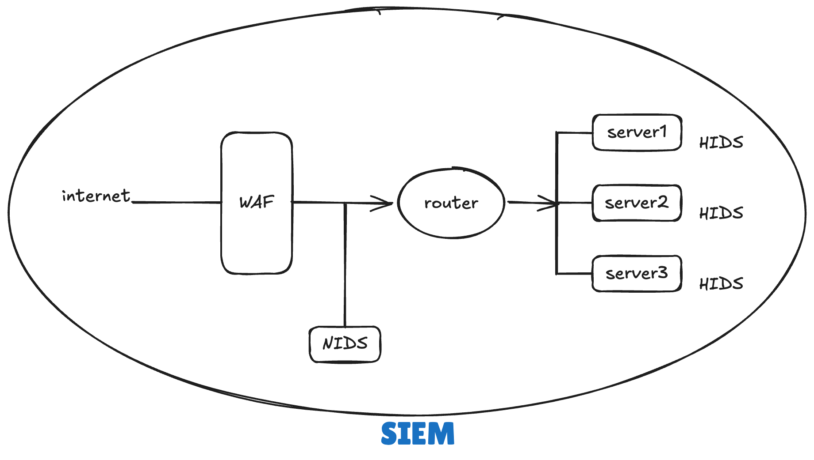
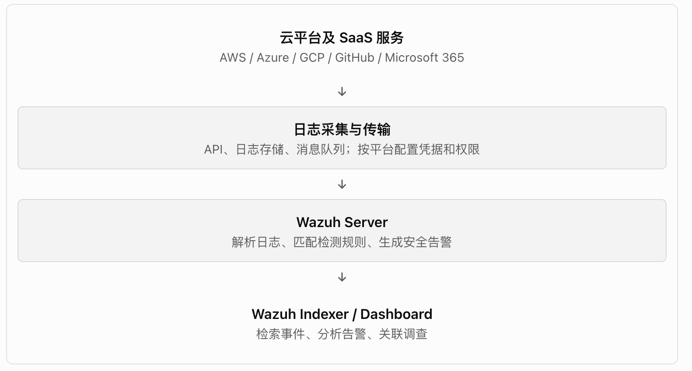

# 🛡️ Lesson 06

## 回顾：当前安全链路



安全链路的部署已基本完成，让我们补上最后一块拼图: **可视化**。

---

## 全链路架构

```
  攻击者
     ▼
┌─────────────────────────────────────────────────────┐
│              被监控的主机/容器                       │
│                                                     │
│  ┌──────────────┐  ┌──────────────┐  ┌───────────┐ │
│  │  WAF (Nginx) │  │ Juice Shop   │  │ Suricata  │ │
│  └──────┬───────┘  └──────┬───────┘  └─────┬─────┘ │
│         │                 │                │       │
│         ▼                 ▼                ▼       │
│  ┌──────────────┐  ┌──────────────┐  ┌───────────┐ │
│  │ Wazuh Agent  │  │ Wazuh Agent  │  │Wazuh Agent│ │
│  │  (WAF 主机)  │  │  (JS 主机)   │  │ (NIDS主机)│ │
│  └──────┬───────┘  └──────┬───────┘  └─────┬─────┘ │
│         │                 │                │       │
│         └─────────────────┼────────────────┘       │
│                           │                        │
└───────────────────────────┼────────────────────────┘
                            │ 采集并转发日志
                            ▼
                     ┌──────────────┐
                     │  Wazuh       │
                     │  Manager     │  ← 你的大脑 (SIEM)
                     │  (SIEM)      │    关联分析、告警生成
                     └──────┬───────┘
                            │ 发送分析后的告警
                            ▼
                     ┌──────────────┐
                     │  Wazuh       │  ← 你的存储
                     │  Indexer     │    (OpenSearch)
                     │  (OpenSearch)│
                     └──────┬───────┘
                            │ 查询
                            ▼
                     ┌──────────────┐
                     │  Wazuh       │  ← 你的指挥中心
                     │  Dashboard   │    https://localhost:443
                     └──────────────┘
```

新增组件
- Wazuh Indexer
- Wazuh Dashboard

---

## 完整防御矩阵

| 攻击类型 | WAF | NIDS | HIDS | SIEM | Dashboard |
|----------|:---:|:----:|:----:|:----:|:---------:|
| SQL 注入 | 🛡️ | | | 📋 | 📊 |
| XSS | 🛡️ | | | 📋 | 📊 |
| 端口扫描 | | 🛡️ | | 📋 | 📊 |
| 文件篡改 | | | 🛡️ | 📋 | 📊 |
| 暴力破解 | | | | 🛡️ | 📊 |

> 🛡️ = 直接检测/拦截 &nbsp;&nbsp; 📋 = 记录并聚合 &nbsp;&nbsp; 📊 = 可视化展示

---

## Dashboard 面板

| 面板 | CISO 看到的问题 |
|------|----------------|
| Security Overview | 我的安全状态有多糟？ |
| Attack Types | 我们主要面临哪些威胁？ |
| Event Timeline | 攻击在什么时候最密集？ |
| Source IPs | 攻击者从哪里来？ |
| Component Health | 我的防御体系完整吗？ |
| Alert Table | 我现在需要处理哪些告警？ |

**访问：https://localhost:443（admin / admin）**

---

## DQL — Dashboard Query Language

在 Dashboard 中筛选和检索告警，使用的是 **DQL**（Dashboard Query Language）。
它运行在 OpenSearch Dashboards 搜索栏中，语法直观，底层自动转换为 Lucene 查询。

### 基本语法：`字段名: 值`

| 场景 | DQL 查询 |
|------|----------|
| WAF 告警 | `rule.groups: waf` |
| SQL 注入 | `rule.groups: sqli` |
| 高严重级别 | `rule.level >= 7` |
| 特定规则 | `rule.id: 100022` |
| 组合条件（AND） | `rule.groups: waf AND rule.level >= 10` |
| 组合条件（OR） | `rule.groups: sqli OR rule.groups: xss` |
| 排除某类事件 | `NOT rule.groups: sca` |
| 通配符匹配 | `data.transaction.request.uri: /rest/*` |

### 实操技巧

1. 在 Dashboard 搜索栏直接输入 DQL 即可实时过滤
2. 点击事件字段可快速添加筛选条件（自动构建 DQL）
3. 用 `rule.level >= 7` 快速定位高风险告警，避免告警疲劳

---

## SIEM 日志存储与成本控制

部署 SIEM（如 Wazuh）时，需要关注日志持续增长带来的存储成本。日志保留策略应综合考虑**监管要求、业务需求和预算限制**。

- **明确保留要求**：根据适用的法律法规、行业规范及企业审计要求，确定日志类型和保留期限。
- **实施分层存储**：近期、高价值的安全日志用于在线检索与分析；需要长期保留的日志可采用低成本归档存储。
- **控制存储成本**：通过日志过滤、合理设置索引范围和自动清理策略，避免无差别地长期存储所有日志。

**核心原则：在满足合规与审计要求的前提下，制定合理的日志保留和存储方案，平衡安全价值与存储成本。**

## Cloud Security 集成方式




Wazuh 不仅可以通过 Agent 监控云主机，还可以接入云平台及 SaaS 服务产生的安全日志，集中进行安全分析、告警和审计。

不同云服务提供的数据接口不同，因此 Wazuh 采用多种方式采集日志。

### 常见集成方式

| 集成方式 | 基本原理 | 典型场景 |
|---|---|---|
| REST API 拉取 | 定期调用云服务 API 获取审计日志或安全事件 | GitHub、Microsoft 365、部分 Azure 服务 |
| 云存储读取 | 从对象存储中读取云服务生成的日志文件 | AWS S3、Azure Blob Storage、Google Cloud Storage |
| 消息队列订阅 | 从消息队列中接收云平台转发的日志 | Google Cloud Pub/Sub |
| Agent 采集 | 在云主机中安装 Wazuh Agent，采集系统日志和安全事件 | AWS EC2、Azure VM、Google Cloud VM |
| 日志转发 | 通过 syslog 或其他日志传输机制接入外部系统日志 | 网络设备、应用程序及其他安全产品 |

具体支持的采集方式取决于对应的 Wazuh 集成模块和云服务能力。

---

## 纵深防御总结

```
Layer 1 — WAF (应用层)    → 拦截 SQL 注入、XSS、目录遍历
Layer 2 — NIDS (网络层)   → 检测端口扫描、网络攻击
Layer 3 — HIDS (主机层)   → 监控文件篡改、可疑进程
Layer 4 — SIEM (分析层)   → 关联分析、暴力破解检测
Layer 5 — Dashboard (展示) → 全局态势感知
```

> **每一层都有自己的盲区，但也有自己独到的视角。多层组合 = 完整的威胁可见性。**

---

## 六课通关总结

| 课 | 安全事件 | 行动 | 能力 |
|----|----------|------|------|
| 01 | 应用裸奔 | 部署并理解危险性 | 攻击面 |
| 02 | SQL 注入 | 部署 WAF | Web 防火墙 |
| 03 | 网络扫描 | 部署 NIDS | 网络检测 |
| 04 | 文件篡改 | 部署 HIDS | 主机检测 |
| 05 | 暴力破解 | 部署 SIEM | 关联分析 |
| 06 | 缺乏可见性 | 部署 Dashboard | 端到端可视化 |

> **攻击发生 → WAF 拦截 → NIDS 检测 → HIDS 监控 → SIEM 聚合 → Dashboard 展示**

---

## 继续探索

课程完成了，但安全之路才刚开始。

建议继续探索：
- 编写 ModSecurity 自定义规则
- 尝试 Suricata 的 IPS 模式（从被动检测到主动拦截）
- 扩展 Wazuh 规则，检测更多类型的威胁
- 研究真实企业安全架构（SOC、SOAR、威胁情报集成）

---

## 安全之路才刚开始

没有 100% 的安全 —— **保持警惕**

## AI


伙伴 ？敌人 ？ 

历史的车轮谁都无法阻挡

打不过 AI, 就加入

用新工具解决新问题，才是面向未来最可靠的路径

---

## 🙏 感谢参与

Security Lab — CISO 安全事件响应实践课程
