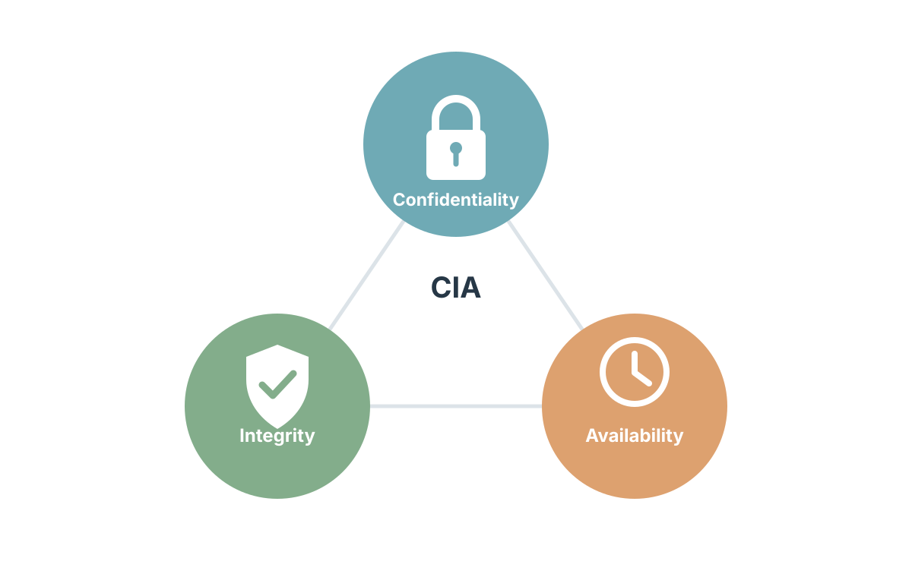
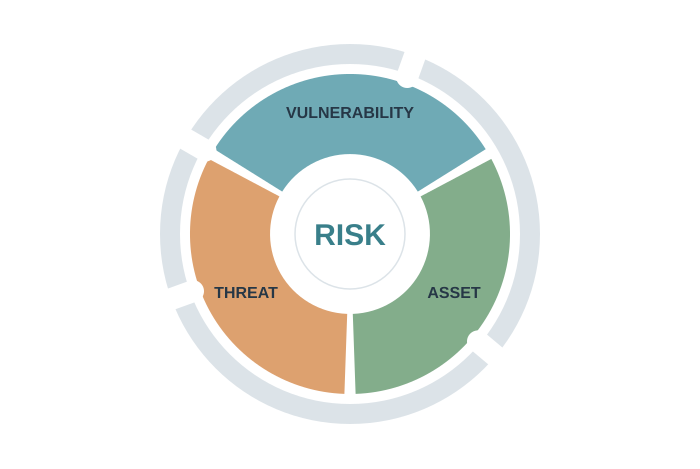
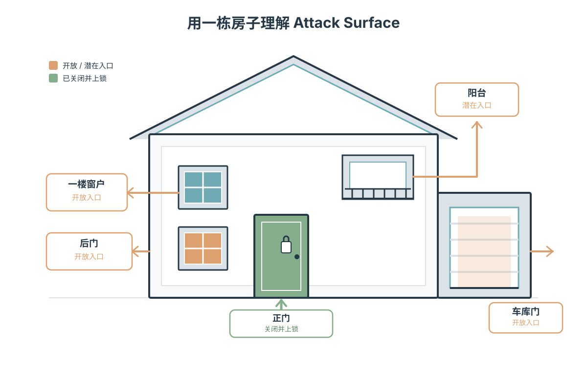
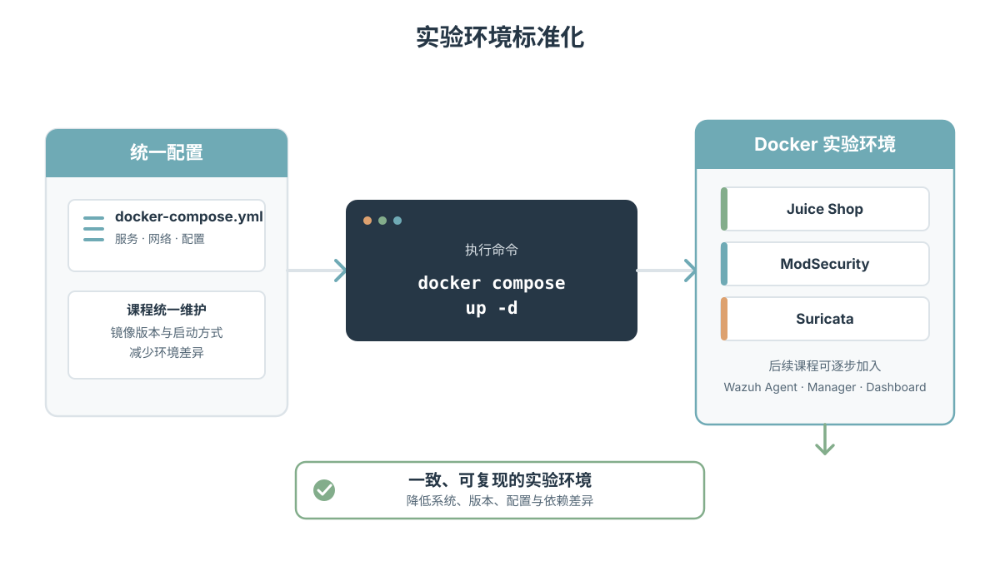
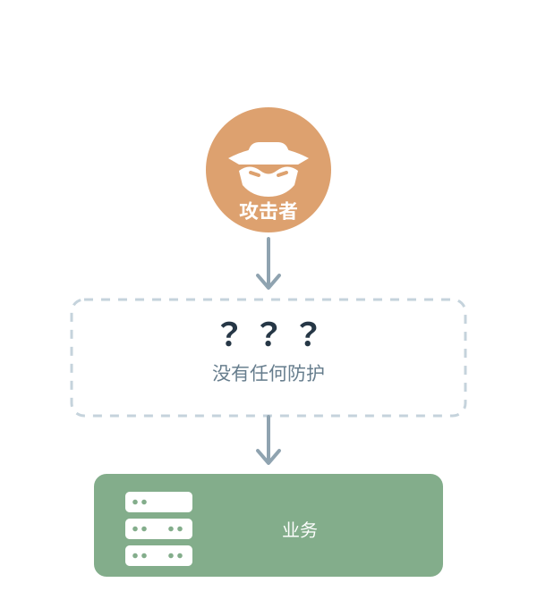

# 第一章 暴露的应用有什么风险？

## 1.1 本章要解决的问题

今天早上 9 点，你刚刚被任命为一家公司的 CISO（Chief Information Security Officer，首席信息安全官）。你坐进办公室，CEO 找到你，问了三个问题：

> 1. **"我们的系统安全吗？"**
> 2. **"如果有人正在攻击我们的系统，你知道吗？"**
> 3. **"如果攻击者已经进入服务器，我们知道吗？"**

如果你还没有建立任何安全监控、检测和响应能力，你可能只能回答："**我不知道。**"

这并不是一个可以接受的答案。作为 CISO，你需要有**证据**来支持你的安全结论。"应该安全"不是一个安全结论，"系统能运行"也不等于"系统安全"。

本章是六章课程的起点。我们不会一开始就安装安全工具，也不会假设系统已经安全。我们要做的第一件事是：

> **站在攻击者的角度，看一遍我们自己的系统，理解它到底暴露了什么。**

本章结束后，你应该能够：

- 区分**资产（Asset）**、**威胁（Threat）**、**漏洞（Vulnerability）**、**风险（Risk）** 和 **影响（Impact）** 这五个核心概念。
- 理解 **攻击面（Attack Surface）** 的含义，并知道攻击面与漏洞数量的区别。
- 通过实验验证一个 Web 应用的暴露状态，识别没有安全防护时的脆弱性。
- 解释"未发现攻击不等于没有攻击"的含义。

## 1.2 安全基础概念：我们在保护什么？

在动手解决问题之前，先建立一组基本概念。这些概念将贯穿整个课程。

### 1.2.1 CIA 三要素

<div align="center">
  
</div>

信息安全的三个基本目标是**Confidentiality**、**Integrity** 和 **Availability**，通常称为 CIA 三要素：

- **Confidentiality**：确保信息只被授权的人访问。例如，用户密码不应该被未授权的人读取。
- **Integrity**：确保信息没有被未授权的修改。例如，订单金额不应该在传输过程中被篡改。
- **Availability**：确保授权用户在需要时能够访问信息和服务。例如，Web 应用应该在用户需要时正常响应。

安全控制的设计通常是为了保护这三个目标中的一个或多个。
在后续章节中，我们会看到不同的安全工具分别侧重于保护哪些目标。

### 1.2.2 资产、威胁、漏洞、风险与影响

| 概念 | 定义 | 示例 |
|---|---|---|
| **资产（Asset）** | 需要保护的资源 | Web 应用、用户数据、服务器 |
| **威胁（Threat）** | 可能对资产造成损害的潜在原因 | 攻击者、恶意软件、内部人员 |
| **漏洞（Vulnerability）** | 资产中可被威胁利用的弱点 | SQL 注入缺陷、未修补的已知漏洞 |
| **风险（Risk）** | 威胁利用漏洞对资产造成损害的可能性 | 攻击者利用 SQL 注入窃取数据的概率 |
| **影响（Impact）** | 风险发生后造成的后果 | 数据泄露、经济损失、声誉损害 |

这五个概念之间存在明确的逻辑关系：

<div align="center">
  
</div>

> **风险 = 威胁 × 漏洞 × 资产价值**

这个公式不是精确的数学计算，而是一种思维方式。它告诉我们：

- 如果没有威胁（没有人想攻击你），即使有漏洞，风险也很低。
- 如果没有漏洞（系统完美无缺），即使有威胁，风险也很低。
- 如果资产价值很低（一个没人用的测试页面），即使有威胁和漏洞，风险也不高。

但现实中，这三个因素往往同时存在。

以 2017 年 Equifax 数据泄露事件为例：

- 资产：约 1.47 亿美国消费者的个人信息。
- 威胁：有组织能力的攻击者，持续寻找和利用已知漏洞。
- 漏洞：Apache Struts 框架中一个已知的远程代码执行漏洞（CVE-2017-5638），官方补丁早已发布但未被及时应用。
- 风险：攻击者利用该已知漏洞入侵系统的可能性极高。
- 影响：大规模数据泄露，Equifax 最终支付高达 7 亿美元的罚款和赔偿。

Equifax 事件的关键教训不是"黑客太厉害了"，而是企业安全体系在多个环节同时失效：
- 已知漏洞未及时修复
- 资产和漏洞管理存在问题
- 攻击检测能力不足
- 事件响应迟缓

作为 CISO，不能只问"我们的代码有没有漏洞"，而需要回答:

- 我们知道哪些资产存在漏洞吗？
- 漏洞有没有及时修复？
- 如果攻击者利用漏洞，我们能不能发现？

### 1.2.3 攻击面（Attack Surface）

> **攻击面**：系统暴露给潜在攻击者的所有入口点的总和。

攻击面不是漏洞数量。这两个概念经常被混淆，但它们有明确的区别：

- **攻击面**告诉我们"攻击者有哪些入口"。
- **漏洞**告诉我们"这些入口中哪些存在安全缺陷"。

用一个生活中的例子来理解。假设你住的是一栋房子，你有正门、后门、阳台、一楼窗户和车库。如果只有正门开放且安装了门锁，攻击者的入口只有一个。如果正门开着、后门开着、一楼窗户开着、车库门也开着，那么攻击面就非常大。

<div align="center">
  
</div>

对于线上服务来说，攻击面的大小取决于：

- 对外开放的网络端口数量
- 公开的 API 接口数量
- Web 应用的输入点（表单、搜索框、文件上传）
- 第三方服务集成
- 管理和维护接口

一个系统可能有 100 个开放接口（这是攻击面），其中 5 个接口存在 SQL 注入缺陷（这是漏洞）。攻击面大不一定意味着已经被攻破，但**攻击面越大，攻击者找到可利用入口的概率就越高**。

## 1.3 实验环境：Juice Shop 与 Docker

### 1.3.1 为什么使用 Juice Shop？

本课程使用 [OWASP Juice Shop](https://owasp.org/www-project-juice-shop/) 作为实验对象。Juice Shop 是一个故意包含多种安全漏洞的 Web 应用，由 OWASP（Open Web Application Security Foundation）维护。它内置了以下类型的漏洞：

- SQL 注入（SQL Injection）
- 跨站脚本（XSS）
- 不安全的直接对象引用（IDOR）
- JWT 令牌操纵
- 敏感信息泄露
- Broken Access Control

为什么不直接拿一个真实的网站来实验？因为对真实系统进行攻击测试是不负责任的，可能违反法律。安全实验必须在**自己控制的环境**中进行。Juice Shop 提供了一个既有真实 Web 应用感觉、又完全可控的实验靶场。

需要明确的是：**Juice Shop 是故意脆弱的教学工具，不代表生产系统应该有的状态。** 它的价值在于让我们能够安全地观察和理解漏洞的表现形式。

### 1.3.2 为什么使用 Docker Compose？

随着课程的推进，实验环境会变得越来越复杂：

- 第一课：只有 Juice Shop
- 第二课：Nginx + ModSecurity（WAF）+ Juice Shop
- 第三课：以上组件 + Suricata（NIDS）
- 后续课程：Wazuh Agent、Wazuh Manager、OpenSearch、Dashboard

如果全部手工安装，实验环境很容易出现问题：不同学员的操作系统不同、软件版本不同、配置不同、依赖不同。最终可能出现"为什么你的能跑，我的不能跑？"的情况。

Docker Compose 解决的是**实验环境标准化**的问题：

<div align="center">

</div>

但需要强调一个重要的概念：

> **容器是部署技术，不是自动生成的安全边界。**

把应用放进 Docker 并不意味着它自动安全。容器仍然可能存在网络暴露、权限问题、镜像漏洞、配置错误等风险。Docker 只是让我们更方便地建立和隔离实验环境，它本身不是安全防护措施。

### 1.3.3 实验环境搭建

本课的实验材料位于 `lesson-01` 目录。首先查看 Docker Compose 配置：

```yaml
# lesson-01/docker-compose.yml
networks:
  web-net:
    driver: bridge

services:
  juice-shop:
    image: bkimminich/juice-shop:latest
    container_name: juice-shop
    networks:
      - web-net
    ports:
      - "3000:3000"
    restart: unless-stopped
```

这个配置做了以下几件事：

1. 创建了一个名为 `web-net` 的 Docker bridge 网络。
2. 从 Docker Hub 拉取 `bkimminich/juice-shop:latest` 镜像。
3. 将容器的 3000 端口映射到宿主机的 3000 端口。
4. 容器命名为 `juice-shop`。

启动实验环境：

```bash
cd lesson-01
docker compose up -d
```

`-d` 参数表示以 detached 模式在后台运行容器。启动后，验证容器状态：

```bash
docker compose ps
```

你应该看到 `juice-shop` 容器的状态为 `Up`。如果状态不是 `Up`，可以通过日志排查：

```bash
docker compose logs
```

作为 CISO，你不能只靠"感觉系统在运行"来判断状态。你需要**证据**。容器状态、日志、HTTP 响应都是证据。

## 1.4 动手实验：验证应用的暴露状态

现在，我们来验证这个应用到底暴露了什么。

### 1.4.1 Step 1：验证应用是否可达

首先确认应用确实在运行：

```bash
curl -s -o /dev/null -w "%{http_code}" http://localhost:3000
```

这条命令的含义是：

- `-s`：静默模式，不显示进度条。
- `-o /dev/null`：丢弃响应体，因为我们只关心状态码。
- `-w "%{http_code}"`：输出 HTTP 状态码。

如果返回 `200`，说明应用正常响应。如果返回 `000` 或其他错误码，说明应用不可达，需要检查 Docker 容器状态。

你也可以直接在浏览器中访问 `http://localhost:3000`，应该能看到 Juice Shop 的首页。但这只是一个视觉确认。作为 CISO，你需要更具体的证据。

### 1.4.2 Step 2：验证公开 API 可被直接访问

Juice Shop 提供了一些公开的 REST API 接口。尝试直接访问产品 API：

```bash
curl http://localhost:3000/rest/products
```

这条命令会返回一个 JSON 数组，包含所有产品的信息。注意：

- **没有认证**。不需要登录，不需要令牌，不需要任何凭证。
- **没有访问控制**。任何人只要能访问 3000 端口，就能获取这些数据。
- **返回完整数据**。不是分页的，不是部分字段，而是完整的产品记录。

思考一个问题：**如果这是生产环境，把所有产品的完整数据通过一个无需认证的 API 公开，合理吗？**

这不是一个纯粹的技术问题，而是一个业务风险问题。某些公开数据（如商品目录）可能确实应该公开，但关键是要**知道哪些数据被公开了、是否有意公开、公开的范围是否合理**。

### 1.4.3 Step 3：验证 SQL 注入请求直达后端

现在尝试一个恶意请求。在 Juice Shop 的产品搜索功能中，输入一个 SQL 注入载荷：

```bash
curl -s "http://localhost:3000/rest/products/search?q=%27%20OR%201%3D1%20--"
```

这里 `%27` 是单引号 `'`，`%20` 是空格，`%3D` 是等号 `=`。解码后，搜索参数实际上是：

```text
' OR 1=1 --
```

这是一个经典的 SQL 注入尝试。它的目的是改变后端 SQL 查询的逻辑，让查询条件始终为真，从而返回所有数据。

观察返回结果：

- 如果返回 `200` 状态码并返回了数据，说明**请求到达了后端并得到了响应**。
- 如果返回 `500` 状态码，说明**请求影响了后端应用**（可能触发了异常）。
- 如果返回 `403` 状态码，说明**请求被某个中间层拦截了**。

在本课的环境中，**没有 WAF、没有代理层、没有网络检测设备**。请求直接从你的浏览器或 curl 到达 Juice Shop 应用。这意味着：

> **任何能够访问 3000 端口的人，都可以发送这类请求，并且请求会直接到达后端应用。**

### 1.4.4 完整验证脚本

我们提供了一个完整的验证脚本 `attack.sh`，它自动执行上述步骤并输出结构化的结果：

```bash
bash attack.sh
```

脚本输出示例：

```
============================================
  Lesson 01: Vulnerable Web App Demo
============================================

[Step 1] 检查 Juice Shop 是否可访问...
  ✓ Juice Shop 正常运行 (HTTP 200)

[Step 2] 获取公开 API 数据（无防护的 API 接口）...
  API 返回数据 (前200字符): [{"id":1,"name":"Apple Juice",...

[Step 3] 尝试 SQL 注入（无 WAF 防护，请求应正常到达后端）...
  注入请求返回 HTTP 200
  ✓ 请求直达后端，未被 WAF 拦截（非 403）
  返回 200 说明 SQL 注入已影响应用（200=正常响应 / 500=后端异常）

[Step 4] Docker 网络信息...
  运行的容器:
  NAME          STATUS         PORTS
  juice-shop    Up (healthy)   0.0.0.0:3000->3000/tcp

============================================
  结论
============================================
  Juice Shop 暴露在公网，没有任何安全防护。
  API 接口可直接访问，SQL 注入请求直达后端。
  下一课：部署 WAF (Nginx + ModSecurity) 来保护它！
============================================
```

这个脚本的意义不是"运行一下看结果"，而是**模拟攻击者对刚上线系统进行最基本的侦察和攻击**。每一步都在验证一个安全假设：

| 步骤 | 验证的假设 | 安全含义 |
|---|---|---|
| Step 1 | 应用在运行 | 业务可用性 |
| Step 2 | API 无需认证即可访问 | 数据暴露风险 |
| Step 3 | 恶意请求直达后端 | 无应用层防护 |

## 1.5 实验结果分析

### 1.5.1 HTTP 状态码的含义

在 Web 安全中，HTTP 状态码是判断请求处理结果的重要依据，但需要正确理解其含义：

- **200 OK**：请求被成功处理。在 SQL 注入实验中返回 200，说明应用接收并处理了这个恶意请求。这**不意味着注入成功**，但意味着请求没有被任何中间层拦截。
- **403 Forbidden**：服务器理解请求但拒绝执行。如果在 SQL 注入实验中返回 403，通常意味着有某个中间层（如 WAF）识别并拒绝了该请求。
- **500 Internal Server Error**：服务器遇到了意外情况。在 SQL 注入实验中返回 500，可能意味着恶意输入触发了后端应用的异常。

**重要**：不能仅凭 HTTP 状态码断定请求是由 WAF 拦截的。403 可能来自 Nginx、来自应用本身、也可能来自 WAF。需要结合响应体内容、日志和配置来确认拦截发生在哪个层级。这在后续课程中会详细讨论。

### 1.5.2 CISO 安全审计清单

基于实验结果，我们可以整理一份安全审计清单：

| 检查项 | 当前状态 | 风险 |
|---|---|---|
| 应用可以访问 | ✅ 正常运行 | 业务可用，但暴露面存在 |
| 有 WAF 保护 | ❌ 无 | 恶意请求直达后端 |
| 有网络入侵检测 | ❌ 无 | 端口扫描、异常流量无法感知 |
| 有主机监控 | ❌ 无 | 文件篡改、异常进程无法感知 |
| 有日志分析（SIEM） | ❌ 无 | 即使有日志也无法自动分析 |
| 有安全态势感知 | ❌ 无 | 无法全局了解安全状态 |

大家注意一个非常有意思的现象：**应用是绿色的**——它可以启动，API 可以返回数据，用户可以访问。但是**安全体系是红色的**——没有任何防护、检测、分析和响应能力。

这正是企业里常见的情况：开发团队说"服务没问题"，运维团队说"机器没问题"，但 CISO 问的是"如果有人攻击它呢？"这是完全不同的问题。

## 1.6 能力边界与局限

在得出任何安全结论之前，必须理解本实验的能力边界和局限。

### 1.6.1 Juice Shop 是故意脆弱的教学工具

Juice Shop 的设计目标就是包含漏洞，它是一个**安全靶场**，不是生产系统。因此：

- 在 Juice Shop 中发现漏洞**不能证明**真实系统也有同样的漏洞。
- Juice Shop 的漏洞是**已知的、文档化的**，而真实系统的漏洞通常是未知的。
- 攻击 Juice Shop 是在**授权的控制环境**中进行的，而对真实系统的未授权攻击是违法的。

本实验的价值在于理解"当一个 Web 应用暴露在互联网上时，它可能面临什么类型的攻击"，而不是"证明 Juice Shop 不安全"（它本来就是故意不安全的）。

### 1.6.2 实验环境的隔离性

本实验运行在本地的 Docker 容器中，与真实的企业网络环境有显著差异：

- 没有真实的互联网流量（只有你手动发起的请求）。
- 没有真实的攻击者（只有你模拟的攻击请求）。
- 没有与其他系统的交互（没有数据库集群、没有 CDN、没有负载均衡）。
- 没有生产环境的复杂度（没有历史遗留系统、没有第三方集成）。

这些差异意味着：**实验验证的原理可以推广到真实场景，但实验本身不模拟真实场景的全部复杂度。**

### 1.6.3 单次测试不能证明"安全"或"不安全"

执行一次 SQL 注入测试并观察到响应，**不能得出以下结论**：

- ❌ "这个应用存在 SQL 注入漏洞"（需要更深入的测试来确认）。
- ❌ "这个应用是安全的"（一次测试不覆盖所有攻击面）。
- ❌ "这个应用已经被攻击了"（我们的测试是授权的实验行为）。

我们能得出的结论是：

- ✅ 请求可以直接到达后端应用，中间没有任何拦截层。
- ✅ 应用对外部输入进行了处理（返回了响应，没有直接拒绝连接）。
- ✅ 如果有人在未授权的情况下发送类似请求，应用无法在请求到达之前拦截它。

### 1.6.4 没有检测能力 = 不知道是否被攻击

这是本课最重要的结论之一：**当前环境没有任何独立的检测机制。** 这意味着：

- 如果有人（不是你）在另一个时间对 3000 端口发送了恶意请求，你**不会知道**。
- Juice Shop 自身的访问日志确实会记录请求，但**没有被采集、分析和告警**。即使日志存在，也没有人自动查看它们。
- 没有网络流量监控，所以即使有大量扫描或异常连接，也没有独立的安全设备记录这些行为。

> **未发现攻击 ≠ 没有攻击。**

这可能是因为攻击确实没有发生，也可能是因为你的检测能力不足以发现攻击。在没有建立检测能力的情况下，你无法区分这两种情况。

## 1.7 从攻击面到安全体系

### 1.7.1 安全工作的基本思路

通过本章的实验，我们应该建立以下安全工作思路：

- 我有什么资产？
- 哪些资产暴露在外？
- 哪些服务可以访问？
- 哪些入口存在风险？
- 哪些攻击能够被发现？
- 哪些攻击能够被阻断？

这不是一个一次性的检查清单，而是一个持续的过程。资产的暴露面会随着新功能的上线、网络配置的变化、第三方服务的集成而不断变化。

安全工作的第一步不是"安装一个安全产品"，而是**资产发现（Asset Discovery）**——先知道自己有什么，才能知道自己需要保护什么。

### 1.7.2 纵深防御的引入

当前，攻击者和我们的应用之间**没有任何东西**。如果攻击者能够访问 3000 端口，他就可以直接发送请求。这种状态在企业安全中是不可接受的。

我们需要在攻击者和应用之间建立多层次的防护。这被称为**纵深防御（Defense in Depth）**：

<div align="center">
  
</div>


在后续课程中，我们将逐步建立以下防护层：

1. WAF（Web 应用防火墙）：在请求到达应用之前，识别并拦截恶意的 Web 请求。（第二章）
2. NIDS（网络入侵检测系统）：监控网络流量，识别端口扫描等网络侦察行为。（第三章）
3. HIDS（主机入侵检测系统）：在主机内部监控文件变化、异常进程和日志事件。（第四章）
4. SIEM（安全信息和事件管理）：采集和分析来自多个源的安全日志，生成告警。（第五章）
5. Dashboard（态势感知）：将安全数据可视化，让安全团队能够全局了解安全状态。（第六章）

这些防护层各自解决不同的问题，也各自有不同的能力边界。没有任何单一工具能够覆盖所有安全风险。

## 1.8 本章总结

回到 CEO 的三个问题。在完成了本章的实验和分析后，你现在可以这样回答：

> **"我们的系统安全吗？"**
>
> 目前不能这么说。应用暴露在互联网上，没有任何防护层。恶意请求可以直达后端。
>
> **"如果有人正在攻击我们的系统，你知道吗？"**
>
> 目前我们不知道。没有独立的检测机制，即使有攻击发生，我们也不会收到告警。
>
> **"如果攻击者已经进入服务器，我们知道吗？"**
>
> 目前我们不知道。没有主机监控，文件被修改、异常进程运行我们都无法感知。

这不是一个令人满意的答案。但它是一个**诚实的、基于证据的答案**。知道了问题在哪里，我们才能开始解决问题。

本章的核心要点可以总结为五句话：

1. **系统能运行，不代表系统安全。** 业务可用性和安全性是两个维度的评估。
2. **安全的第一步，是知道自己暴露了什么。** 不知道资产和攻击面，就无法建立有效的防护。
3. **攻击面是攻击者可以利用的所有入口。** 入口越多，找到可利用漏洞的概率越高。
4. **漏洞只是风险的一部分，检测和响应同样重要。** 即使无法阻止所有攻击，至少应该能够发现和响应。
5. **安全不是一个工具，而是一套完整的系统。** WAF、NIDS、HIDS、SIEM 各自解决不同的问题，需要协同工作。

## 1.9 练习与思考题

### 练习题

1. 在你的实验环境中，访问 `http://localhost:3000/rest/products/search?q=' OR 1=1 --`，观察返回结果。与正常搜索请求（如 `http://localhost:3000/rest/products/search?q=apple`）的返回结果进行比较。你发现了什么差异？这说明了什么？

2. 使用 `docker compose logs` 查看 Juice Shop 的容器日志。找到你的 curl 请求对应的日志条目。日志中记录了哪些信息（时间、请求路径、状态码等）？这些日志是否被自动分析或告警？

3. 在本实验的 Docker Compose 配置中，Juice Shop 的 3000 端口被映射到宿主机的 3000 端口（`"3000:3000"`）。这意味着任何能够访问宿主机 3000 端口的设备都可以访问 Juice Shop。如果这是一台连接互联网的服务器，你认为这个配置安全吗？应该如何改进？

### 思考题

4. 攻击面与安全投入之间的关系。如果一个企业有 100 个对外开放的服务，另一个企业只有 10 个，哪个企业的安全投入应该更多？为什么？

5. 假设你是某公司的 CISO，开发团队报告说他们已经修复了一个已知的 SQL 注入漏洞。这是否意味着公司的 Web 应用不再面临 SQL 注入的风险？还需要考虑哪些因素？

6. 在没有建立检测能力的情况下，如何向 CEO 证明"我们没有被攻击"？这个证明本身是否存在逻辑问题？

### 拓展阅读

- [OWASP Top 10](https://owasp.org/www-project-top-ten/)：Web 应用最常见的十类安全风险。
- [NIST Cybersecurity Framework (CSF) 2.0](https://www.nist.gov/cyberframework)：美国国家标准与技术研究院发布的网络安全框架，包含 Govern（治理）、Identify（识别）、Protect（防护）、Detect（检测）、Respond（响应）、Recover（恢复）六个功能领域。
- [MITRE ATT&CK](https://attack.mitre.org/)：基于真实攻击行为的知识库，按战术（Tactics）和技术（Techniques）分类，帮助你理解攻击者可能采取的行动。

---

> **下一章预告**
>
> 今天你作为 CISO，发现公司的 Web 应用暴露在互联网上，没有任何防护。恶意请求可以直达后端。
>
> CEO 又来问你："你不是说我们的系统安全吗？"
>
> 你现在知道应该怎么回答了。你会说："现在还不能这么说。第一步，我要在 Web 应用前面增加一道防线。"
>
> **第二章将解决：能否在请求到达应用之前，拦截部分攻击？** 我们会在应用前面部署 Nginx + ModSecurity + OWASP CRS，建立第一道应用层防护线（WAF），然后亲手发起 SQL 注入和 XSS 攻击，看看这道防线到底能不能挡住攻击。
