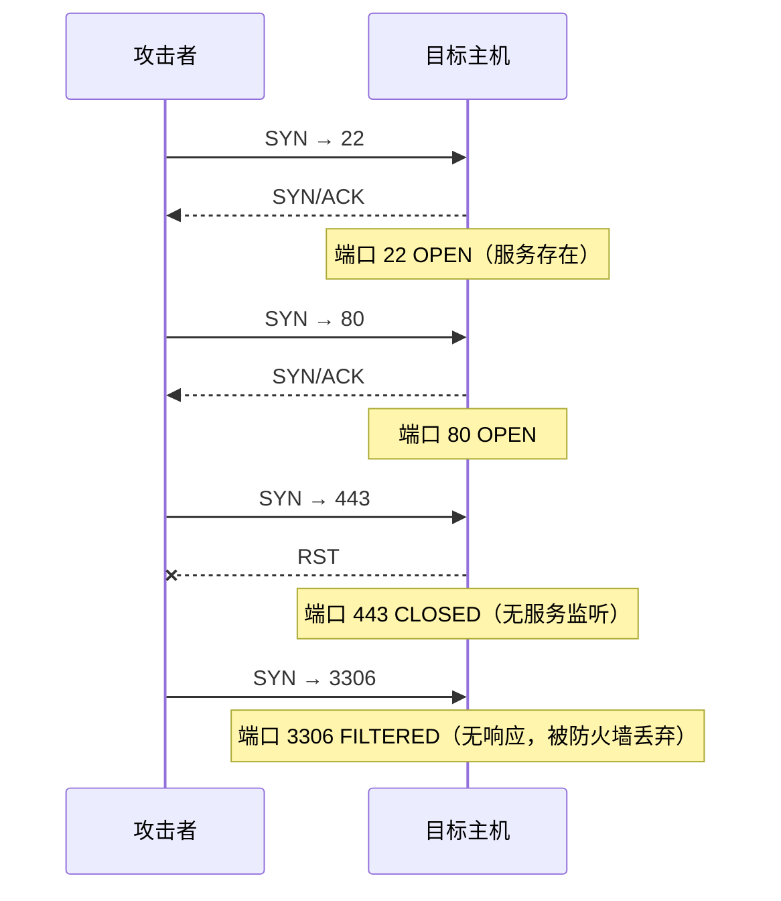
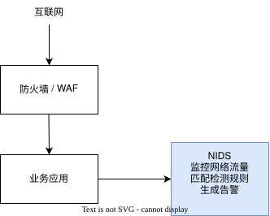
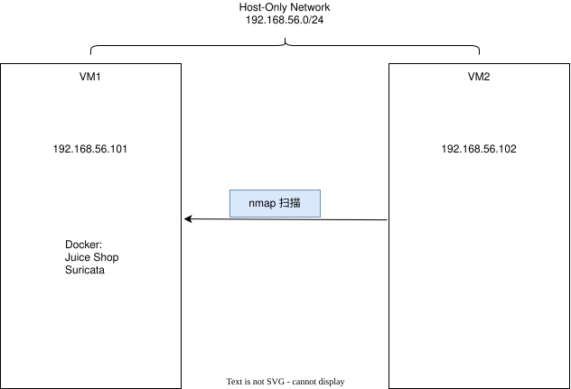

# 第三章 能否发现网络侦察行为？

## 3.1 本章要解决的问题

前两章，我们作为 CISO 看到了两个关键事实：

1. **应用暴露在互联网上**，没有防护层时，恶意请求可以直接到达后端（第一章）。
2. **WAF 可以在请求到达应用之前拦截部分攻击**，但它只面向 HTTP 应用层（第二章）。

现在 CEO 提出了一个新的问题：

> **"如果攻击者还没有开始攻击我们的 Web 应用，而是在网络上侦察我们的主机——我们能发现吗？"**

这个问题很关键。大多数入侵不是一步到位的，攻击者通常会先"踩点"：扫描你的网络，看看哪些端口开着、跑着什么服务、有没有已知的漏洞。这种侦察行为本身就是一种**可以被观察到的网络活动**。

如果连攻击者在扫描你的网络都看不到，那么后续的攻击就更不可能被发现。

本章结束后，你应该能够：

- 理解网络侦察的目的以及端口扫描在实际入侵中的角色。
- 解释 Nmap 扫描的工作原理，以及 Open、Closed、Filtered 三种端口状态的含义。
- 理解 **NIDS（Network Intrusion Detection System）** 的工作位置、检测方式和能力边界。
- 通过端口扫描对照实验，验证 Suricata 是否能够检测到网络侦察行为。
- 从 Suricata 的 EVE JSON 告警中提取关键证据并解释其含义。
- 理解"网络不可见""规则未匹配"和"未产生告警"之间的区别。

## 3.2 杀伤链与网络侦察

### 3.2.1 攻击的阶段性

洛克希德·马丁公司提出了**网络杀伤链（Cyber Kill Chain）** 框架，将一次完整的网络攻击拆分为七个有序阶段：

| 阶段 | 攻击者在做什么 |
|---|---|
| 1. 侦察（Reconnaissance） | 收集目标信息：IP 地址、域名、员工信息 |
| 2. 武器化（Weaponization） | 制作针对目标漏洞的利用工具 |
| 3. 交付（Delivery） | 通过网络钓鱼、恶意附件等方式投送攻击载荷 |
| 4. 利用（Exploitation） | 触发目标系统上的漏洞 |
| 5. 安装（Installation） | 植入后门或恶意软件 |
| 6. 指挥与控制（C2） | 建立持续控制通道 |
| 7. 目标行动（Actions on Objectives） | 窃取数据、破坏系统、勒索等 |

杀伤链的核心价值在于：**它把模糊的"被入侵"拆解成可枚举的环节，从而可以在每一环设置检测点。** 如果我们在第一环——侦察阶段——就能发现攻击者的行为，就有可能在入侵早期发出预警。

### 3.2.2 端口扫描：侦察阶段的核心手段

端口扫描的目的是**发现目标主机上开放的网络服务**。

网络服务通过 TCP/UDP 端口对外提供访问。如果攻击者知道你开放了哪些端口，就可以推断出你运行了什么服务，再结合已知漏洞数据库（如 CVE），就可能找到可入侵的入口。

**每个开放的端口都是一个潜在的入口点：**

| 端口 | 常见服务 | 风险 |
|---|---|---|
| 22 | SSH | 远程管理入口，弱口令风险 |
| 80 | HTTP | Web 应用入口 |
| 3306 | MySQL | 数据库端口，通常不应暴露 |
| 3000 | Node.js | 应用服务（如 Juice Shop） |

### 3.2.3 端口扫描的工作原理

Nmap（Network Mapper）是最常用的端口扫描工具。它的本质是**向目标发送探测报文并观察响应**。

以 TCP SYN 扫描（`nmap -sS`）为例：



根据目标的响应，Nmap 判断端口状态：

- **Open（开放）**：目标返回 SYN/ACK，说明该端口有服务正在监听。这是攻击者最关心的结果。
- **Closed（关闭）**：目标返回 RST，说明端口可达但没有服务监听。这意味着主机存在，但该端口不提供访问。
- **Filtered（被过滤）**：没有收到响应（或收到 ICMP 不可达等中间设备响应），说明有防火墙或其他安全设备在中间丢弃了报文。

### 3.2.4 操作系统指纹

Nmap 不仅能发现开放端口，还能通过更复杂的探测报文推断目标操作系统的类型。

其原理是：**不同操作系统对非正常 TCP/IP 报文的行为有细微差别**。通过分析 TCP 初始窗口大小、TTL 值、DF 标志、TCP 选项顺序等特征，Nmap 可以将目标与已知操作系统的指纹数据库进行比对。

例如：

- **Linux 系统**：TTL 初始值通常为 64，TCP 窗口大小多为 29200，TCP 选项顺序常见为 `MSS,SACK,TS,WS`。
- **Windows 系统**：TTL 初始值通常为 128，TCP 窗口大小多样（如 8192、65535），TCP 选项顺序常见为 `MSS,WS,SACK,TS`。

操作系统指纹本身不构成入侵，但它帮助攻击者缩小后续攻击手段的范围——针对 Linux 和 Windows 的漏洞利用方式往往不同。

### 3.2.5 杀伤链的边界

杀伤链模型有其适用范围。它覆盖的是**外部攻击者渗透**这类经典路径，但对以下场景的表达能力有限：

- **内部威胁**：合法员工滥用权限，不需要经过外部入侵阶段。
- **无 C2 阶段的勒索软件**：一些勒索软件直接执行加密，不维持持续的控制通道。
- **供应链投毒**：攻击者通过第三方依赖或更新机制间接入侵，不走传统的侦察→武器化→交付路径。

这些场景需要其他检测方法补充（如 UEBA、EDR、供应链审计）。杀伤链是有用的分析框架，但不是完整的威胁模型。

## 3.3 NIDS：在网络层观察攻击

### 3.3.1 WAF 的局限性

第二章中我们部署了 WAF。WAF 工作在应用层（HTTP/HTTPS），能够检测和拦截 Web 攻击。但它有一个根本性的局限：

> **WAF 只能看到经过它的 HTTP 请求。**

如果攻击者不是在攻击 Web 应用，而是在做以下事情，WAF 看不到：

- 端口扫描（网络层行为）
- 对非 HTTP 服务的攻击（如直接攻击 SSH、MySQL）
- 网络协议攻击
- DDoS 流量洪泛

这就是为什么我们需要在 WAF 之外部署另一种安全控制。

### 3.3.2 NIDS 是什么？

**NIDS（Network Intrusion Detection System，网络入侵检测系统）** 工作在**网络层**，监控流经网络的流量，识别可疑活动并生成告警。

NIDS 的典型工作位置：



NIDS 如何检测端口扫描：

> **短时间内对同一主机的多个端口发起连接 → 行为模式识别 → 生成端口扫描告警**

### 3.3.3 Suricata

本章使用 **Suricata** 作为 NIDS。Suricata 是一个高性能的开源 IDS/IPS 系统，由 OISF（Open Information Security Foundation）开发。

**核心能力：**

- **端口扫描检测**：通过分析短时间内对多端口的连接尝试，识别扫描行为。
- **网络攻击特征匹配**：使用 ET（Emerging Threats）等规则集匹配已知攻击模式。
- **协议异常检测**：分析 HTTP、TLS、DNS、SSH 等协议的异常行为。
- **流量分析**：对网络流量进行深度包检测（DPI）。

**IDS 与 IPS 的区别：**

| 类型 | 全称 | 行为 | 典型部署位置 |
|---|---|---|---|
| IDS | Intrusion Detection System | 发现攻击，生成告警，不主动阻断 | 网络旁路（监控模式） |
| IPS | Intrusion Prevention System | 发现攻击，主动阻断流量 | 网络路径（inline 模式） |

IDS 更像是一个"监控摄像头"——它记录和报警，但不阻止事情发生。IPS 更像是一个"自动门禁"——检测到异常时会主动拦截。本章部署的是 IDS 模式，即 Suricata 观察流量并生成告警，但不主动阻断。

**为什么部署在 IDS 模式而不是 IPS 模式？** 在教学环境中，IDS 模式让我们能够观察所有流量和告警，同时不会因为误拦截而影响实验的正常进行。生产环境中是否使用 IPS 模式取决于对误报的容忍度和业务影响评估。

### 3.3.4 Suricata 如何"看到"流量

这是理解 NIDS 的关键前提：**Suricata 只能检测它能看到流量。**

Suricata 获取流量的方式取决于它的部署位置和网卡配置：

- **镜像端口（SPAN/Port Mirror）**：交换机将所有端口的流量复制一份发送给 Suricata 所在的网卡。这是生产环境中最常见的部署方式。
- **网络 TAP**：在物理线路上分接流量。
- **Host 网络模式**：容器直接访问宿主机的网络栈，从而看到宿主机网卡上的流量。这是本章实验的方式。
- **Bridge 模式**：Suricata 部署在网桥上，所有流量必须经过它。

如果 Suricata 监听的是网卡 A，而攻击流量只经过网卡 B，那么 Suricata 看不到这次攻击，自然也不会产生告警。**"没有告警"可能有三种完全不同的原因：**

1. **确实没有攻击发生。**
2. **攻击发生了，但 Suricata 没有看到相关流量**（网络不可见）。
3. **Suricata 看到了流量，但规则没有匹配到**（规则覆盖不足）。

理解这个区别非常重要——把"没有告警"等同于"没有攻击"是安全监控中最危险的假设之一。

## 3.4 实验环境：Suricata 与 Nmap

### 3.4.1 实验架构

与第二章在单一 Docker 网络内部署的方式不同，本章的实验需要 **Suricata 能够看到宿主机网卡上的网络流量**。为此，Docker Compose 中的 Suricata 容器使用了 `network_mode: host`。

这意味着 Suricata 容器不使用 Docker 的桥接网络，而是直接共享宿主机的网络栈，可以直接监听宿主机网卡上的流量。

查看 `lesson-03/docker-compose.yml`：

```yaml
services:
  juice-shop:
    image: bkimminich/juice-shop:latest
    container_name: juice-shop
    ports:
      - "3000:3000"
    restart: unless-stopped

  suricata:
    image: jasonish/suricata:latest
    container_name: suricata
    network_mode: host          # ← 关键：直接使用宿主机网络栈
    cap_add:
      - NET_ADMIN              # ← 需要原始数据包访问权限
      - NET_RAW
    volumes:
      - ./configs/suricata.yaml:/etc/suricata/suricata.yaml:ro
      - ./configs/rules/custom.rules:/etc/suricata/rules/custom.rules:ro
      - suricata-log:/var/log/suricata
    entrypoint: [sh, -c, "...智能选择网卡并启动 Suricata..."]
    restart: unless-stopped
```

**注意与 lesson-02 的区别：**

| 特性 | lesson-02 | lesson-03 |
|---|---|---|
| Juice Shop 暴露方式 | 通过 WAF（Nginx 80 端口） | 直接暴露（3000 端口） |
| Suricata | 不存在 | host 网络模式 |
| 关注层 | 应用层（HTTP） | 网络层（TCP/IP） |

Suricata 的 entrypoint 脚本会智能选择监听网卡：优先选择 192.168.x.x 网段（VirtualBox Host-Only 网络），其次 10.x/172.x 网段，最后回退到任意可用的非回环网卡。这是为了适应不同的实验网络环境。

### 3.4.2 Suricata 配置

查看 `lesson-03/configs/suricata.yaml`：

```yaml
vars:
  address-groups:
    HOME_NET: "[10.0.0.0/8,172.16.0.0/12,192.168.0.0/16]"
    EXTERNAL_NET: "!$HOME_NET"

default-log-dir: /var/log/suricata

af-packet:
  - interface: default          # 使用 entrypoint 指定的网卡

outputs:
  - eve-log:
      enabled: yes
      filetype: regular
      filename: eve.json
      types:
        - alert:
            payload: yes
            payload-printable: yes
        - stats:
            enabled: yes
            totals: yes

rule-files:
  - /etc/suricata/rules/custom.rules
```

这是一个精简配置，关键说明：

- **HOME_NET** 定义为所有私有地址段。Suricata 将 HOME_NET 之外的流量视为 EXTERNAL_NET。
- **eve-log** 是 Suricata 的主要输出格式，以 JSON 记录告警和统计信息。`payload: yes` 保留了数据包的载荷内容，便于后续分析。
- **规则文件** 只加载了 `custom.rules`，没有加载 ET Open 规则集。

### 3.4.3 自定义检测规则

查看 `lesson-03/configs/rules/custom.rules`：

```
alert tcp any any -> any 3000 (msg:"ET SCAN Port Scan - Juice Shop probe"; sid:1000001; rev:1; classtype:attempted-recon;)
alert tcp any any -> any 3001 (msg:"ET SCAN Port Scan - Juice Shop probe 3001"; sid:1000002; rev:1; classtype:attempted-recon;)
alert tcp any any -> any 3002 (msg:"ET SCAN Port Scan - Juice Shop probe 3002"; sid:1000003; rev:1; classtype:attempted-recon;)
alert tcp any any -> any 3003 (msg:"ET SCAN Port Scan - Juice Shop probe 3003"; sid:1000004; rev:1; classtype:attempted-recon;)
alert tcp any any -> any 3004 (msg:"ET SCAN Port Scan - Juice Shop probe 3004"; sid:1000005; rev:1; classtype:attempted-recon;)
alert tcp any any -> any 3005 (msg:"ET SCAN Port Scan - Juice Shop probe 3005"; sid:1000006; rev:1; classtype:attempted-recon;)
alert tcp any any -> any 8080 (msg:"ET SCAN Port Scan - HTTP-Alt probe"; sid:1000007; rev:1; classtype:attempted-recon;)
alert tcp any any -> any 8443 (msg:"ET SCAN Port Scan - HTTPS-Alt probe"; sid:1000008; rev:1; classtype:attempted-recon;)
```

**规则解析：**

以第一条规则为例：

```
alert tcp any any -> any 3000 (msg:"..."; sid:1000001; rev:1; classtype:attempted-recon;)
```

| 部分 | 含义 |
|---|---|
| `alert` | 动作：匹配时生成告警 |
| `tcp` | 协议：TCP |
| `any any` | 源地址和源端口：任意 |
| `->` | 方向：从源到目的 |
| `any 3000` | 目的地址任意，目的端口 3000 |
| `msg` | 告警消息描述 |
| `sid` | 规则唯一标识（Signature ID） |
| `rev` | 规则版本号 |
| `classtype` | 攻击分类：`attempted-recon`（尝试侦察） |

**规则的含义：** "任何来源的 TCP 数据包，如果目的端口是 3000，就产生告警。"

**需要理解的局限：** 这些规则是**单端口命中即告警**的模式，即看到对目标端口的 TCP 连接尝试就触发。它们是"端口可达性检测"——告诉我们某个端口正在被探测。

在生产环境中，真正的端口扫描检测通常结合**行为分析**：Suricata 的扫描检测引擎会在短时间内对同一主机的多个端口发起连接的流量到达时，自动聚合这些事件并生成更高层级的扫描告警。本章使用简化规则是因为它们更直观，且实验环境中攻击者的扫描行为是明确的。

## 3.5 实验：检测端口扫描

### 3.5.1 实验目标

验证当攻击者使用 Nmap 对目标主机进行 TCP 端口扫描时，Suricata 是否能够检测到这些扫描行为并生成可观察的告警。

### 3.5.2 实验假设

- **条件**：从攻击者主机对目标主机执行 Nmap TCP 连接扫描（`nmap -sT`）。
- **预期**：Suricata 对扫描过程中触发的每个目标端口生成对应的告警。
- **观察点**：Suricata 的 `eve.json` 日志文件。

### 3.5.3 实验前置条件

1. 需要两台可以互相通信的主机（VM1 和 VM2）。
2. VM1 运行 Docker Compose 环境（Juice Shop + Suricata）。
3. VM2 安装了 Nmap。
4. VM2 可以访问 VM1 的网络（例如通过 VirtualBox Host-Only 网络）。

**网络拓扑：**



**为什么需要两台主机？** Suricata 需要监控**来自其他主机的流量**。如果扫描者和目标在同一台机器上，流量可能走回环接口（loopback），而 Suricata 监听的是物理网卡。为了观察真实的网络检测，扫描必须通过网络进行。

### 3.5.4 启动实验环境

在 VM1 上：

```bash
cd lesson-03
docker compose up -d
```

确认服务状态：

```bash
docker compose ps
```

应该看到 `juice-shop` 和 `suricata` 两个容器都在运行。

检查 Suricata 是否正确选择了网卡：

```bash
docker compose logs suricata | grep "Suricata monitoring interface"
```

预期输出类似：

```
suricata | Suricata monitoring interface: enp0s9
```

### 3.5.5 执行端口扫描

在 VM2 上，对 VM1 执行 Nmap TCP 连接扫描：

```bash
# 方法一：使用实验提供的脚本（假设 VM1 IP 为 192.168.56.101）
./attack.sh 192.168.56.101

# 方法二：直接运行 nmap
nmap -sT -p 3000-3005,8080,8443 192.168.56.101
```

`attack.sh` 的本质就是执行上述 Nmap 命令。扫描的目标端口范围覆盖了 `custom.rules` 中定义的所有 8 个端口。

**预期 Nmap 输出：**

```
Starting Nmap 7.xx ( https://nmap.org )
Nmap scan report for 192.168.56.101
Host is up (0.0010s latency).

PORT     STATE  SERVICE
3000/tcp open   ppp
3001/tcp closed unknown
3002/tcp closed unknown
3003/tcp closed unknown
3004/tcp closed unknown
3005/tcp closed unknown
8080/tcp closed http-proxy
8443/tcp closed https-alt

Nmap done: 1 IP address (1 host up) scanned in 0.05 seconds
```

可以看到：
- 端口 3000（Juice Shop）是 **open** 的。
- 其他端口是 **closed** 的（没有服务监听，但主机可达）。

### 3.5.6 观察 Suricata 告警

扫描完成后，在 VM1 上查看 Suricata 生成的告警：

```bash
docker compose exec suricata cat /var/log/suricata/eve.json | jq 'select(.event_type == "alert")'
```

**预期输出（JSON 告警，格式化后）：**

```json
{
  "timestamp": "2026-09-25T09:21:01.953114+0000",
  "flow_id": 1560322157847338,
  "in_iface": "enp0s9",
  "event_type": "alert",
  "src_ip": "192.168.56.102",
  "src_port": 51760,
  "dest_ip": "192.168.56.101",
  "dest_port": 8080,
  "proto": "TCP",
  "alert": {
    "action": "allowed",
    "gid": 1,
    "signature_id": 1000007,
    "rev": 1,
    "signature": "ET SCAN Port Scan - HTTP-Alt probe",
    "category": "Attempted Information Leak",
    "severity": 2
  },
  "flow": {
    "pkts_toserver": 1,
    "pkts_toclient": 0,
    "bytes_toserver": 74,
    "bytes_toclient": 0
  }
}
```

你应该看到 8 条告警，分别对应 8 个被扫描的端口。

**告警数量 = 被扫描且匹配规则的端口数量。** 这是因为每条规则是单端口检测模式。如果扫描了规则之外的端口（比如 22、443），不会产生告警——不是因为 Suricata 没有看到流量，而是因为没有匹配的规则。

### 3.5.7 对照实验：规则覆盖范围之外的端口

为了理解规则的局限性，执行一个规则未覆盖的端口扫描：

```bash
nmap -sT -p 22,443,3306 192.168.56.101
```

然后再次查看告警：

```bash
docker compose exec suricata cat /var/log/suricata/eve.json | jq 'select(.event_type == "alert")' | wc -l
```

**预期结果：** 告警数量不增加。

这个实验说明：**规则定义了 Suricata 能看到什么。没有在规则中的端口，即使被扫描也不会产生告警。** 这不是 Suricata 的能力问题，而是规则覆盖范围的问题。

在生产环境中，你会使用更完整的规则集（如 ET Open Rules）和 Suricata 内置的扫描检测引擎（通过阈值和多端口聚合来识别扫描行为），而不是为每个端口手动编写规则。

## 3.6 EVE 告警日志详解

Suricata 的 `eve.json` 是本章最重要的证据来源。我们来逐字段解读一条告警。

### 3.6.1 基础信息

| 字段 | 示例值 | 含义 |
|---|---|---|
| `timestamp` | `2026-09-25T09:21:01.953114+0000` | 告警产生时间（UTC，ISO8601，含纳秒） |
| `flow_id` | `1560322157847338` | 网络流的唯一标识，用于将同一流的多个事件关联起来 |
| `in_iface` | `enp0s9` | 抓到该流量的入口网卡 |
| `event_type` | `alert` | 事件类型：`alert` = 命中检测规则 |
| `pkt_src` | `wire/pcap` | 数据来源：`wire/pcap` = 实时抓包 |

### 3.6.2 网络五元组

五元组（源 IP、源端口、目的 IP、目的端口、协议）是描述一次网络连接的最小信息集：

| 字段 | 含义 |
|---|---|
| `src_ip` / `src_port` | 源地址：发起扫描的主机（如 `192.168.56.102:51760`） |
| `dest_ip` / `dest_port` | 目的地址：被扫描的主机（如 `192.168.56.101:8080`） |
| `proto` | 协议：TCP |
| `direction` | 流方向：`to_server` = 客户端发往服务端 |

通过五元组，你可以确认：
- **谁在扫描**（`src_ip`）。
- **扫描了谁**（`dest_ip`）。
- **扫描了哪些端口**（`dest_port`）。
- **使用了什么协议**（`proto`）。

### 3.6.3 alert 对象

| 字段 | 含义 |
|---|---|
| `action` | `allowed` = 放行且仅告警（IDS 模式默认；IPS drop 模式会显示 `drop`/`reject`） |
| `gid` | 规则组 ID，`1` = 默认规则组 |
| `signature_id` | 规则编号（如 `1000007`） |
| `rev` | 规则修订版本号 |
| `signature` | 规则描述（如 `"ET SCAN Port Scan - HTTP-Alt probe"`） |
| `category` | 攻击类别（如 `"Attempted Information Leak"`） |
| `severity` | 严重级别：1 = 高 / 2 = 中 / 3 = 低 |

### 3.6.4 flow 对象

| 字段 | 含义 |
|---|---|
| `pkts_toserver` / `pkts_toclient` | 已见到的上行/下行包数 |
| `bytes_toserver` / `bytes_toclient` | 对应的字节数 |
| `start` | 流开始时间 |

`pkts_toserver: 1, pkts_toclient: 0` 表示 Suricata 只看到了从扫描者到目标的 1 个数据包（SYN 包），还没有看到目标的响应。这与 SYN 扫描或连接扫描的初始阶段一致。

### 3.6.5 字段 `stream`

在部分告警中你会看到 `stream: 0`。这表示该告警**不关联到流重组上下文**——即它是根据单个报文的特征触发的，而不是基于 TCP 流重组后的内容分析。端口扫描检测通常是基于报文特征（SYN 包到达特定端口），所以不会绑定到流级状态。

## 3.7 NIDS 与 WAF 的关系

回顾第二章部署的 WAF 和本章部署的 NIDS，它们的关系是**互补**而非替代：

| 攻击类型 | WAF 能看到？ | NIDS 能看到？ |
|---|---|---|
| SQL 注入 | ✅ 应用层 HTTP 参数 | ❌ 除非使用特定规则 |
| XSS | ✅ 应用层 HTTP 参数 | ❌ |
| 端口扫描 | ❌ 网络层行为 | ✅ |
| 网络协议攻击 | ❌ | ✅ |
| DDoS | ❌ | ⚠️ 部分可见 |

> **WAF 工作在应用层（HTTP），NIDS 工作在网络层（TCP/IP）。它们互补，不替代。**

一个完整的防御体系需要多层安全控制。每一层看到的东西不同，解决的问题不同。没有哪一层可以单独构成"完整的安全"。

## 3.8 常见故障排查

### 3.8.1 Suricata 没有产生任何告警

可能的原因：

1. **Suricata 没有启动成功。** 检查：`docker compose logs suricata`。如果看到权限错误，确认 `cap_add` 中包含了 `NET_ADMIN` 和 `NET_RAW`。
2. **Suricata 监听了错误的网卡。** 检查日志中的 `Suricata monitoring interface` 行，确认它选择了正确的网卡。
3. **扫描流量没有经过 Suricata 监听的网卡。** 如果 VM1 有多个网卡（如 NAT + Host-Only），确认 Suricata 监听的是 VM2 能访问的那个。
4. **规则文件没有正确挂载。** 检查：`docker compose exec suricata cat /etc/suricata/rules/custom.rules`。

### 3.8.2 扫描了端口但没有告警

这是理解规则覆盖范围的对照实验场景：

1. 确认扫描的端口在 `custom.rules` 中有对应的规则。
2. 扫描了规则之外的端口（如 22、443）不会产生告警——这不是 bug，而是规则未覆盖。
3. 确认 Suricata 确实看到了流量（检查 `stats` 输出中的 `capture.kernel_packets` 是否在增加）。

### 3.8.3 Nmap 无法连接目标

1. 确认 VM1 和 VM2 在同一网络段（如都是 `192.168.56.0/24`）。
2. 确认 VM1 的防火墙没有阻止 Nmap 的探测报文。
3. 确认 Juice Shop 容器在运行：`docker compose ps`。

## 3.9 能力边界与局限

### 3.9.1 本章实验的局限

当前实验配置有以下局限性，理解它们对建立正确的安全认知很重要：

1. **规则覆盖范围窄。** `custom.rules` 只定义了 8 个特定端口的单端口检测规则。扫描其他端口不会产生告警。生产环境中应使用完整的 ET Open 规则集。
2. **没有加载 ET Open 规则集。** Suricata 的核心价值之一是其庞大的规则库（数万条规则）。当前配置完全没有利用这一点，仅用于演示原理。
3. **单端口命中 vs 行为聚合。** 当前规则是"看到 TCP 包到端口 X 就告警"。真正的扫描检测应基于**行为分析**——在短时间内对多个端口发起连接时聚合为一条"端口扫描"告警，而不是每个端口一条。
4. **实验环境简化了网络拓扑。** 生产环境中，流量可能经过多个交换机、路由器、防火墙和负载均衡器。Suricata 需要部署在能够看到相关流量的位置。

### 3.9.2 NIDS 的一般性能力边界

除了实验配置的限制，NIDS 本身也有固有限制：

1. **加密流量。** 如果流量使用 TLS 加密，NIDS 无法看到加密载荷的内容。它仍然可以看到 TCP 连接（IP 和端口），但无法分析应用层数据。
2. **只能看到经过它的流量。** 如果攻击者的流量绕过了 Suricata 监听的网卡（如通过不同的网络路径），NIDS 无法检测。
3. **误报与漏报。** 基于规则匹配的检测必然面临两个问题：
   - **误报（False Positive）**：正常流量被误判为攻击。
   - **漏报（False Negative）**：攻击流量没有匹配到任何规则。
4. **端口扫描告警 ≠ 系统已经被攻陷。** 端口扫描只是侦察阶段的行为，它告诉你有人在观察你的网络，但不代表对方已经成功入侵。这就像有人在你家门口探头探脑——你知道有人在观察，但不能因此断定他已经开始偷东西了。
5. **NIDS 看不到主机内部。** 如果攻击者已经获得了主机的访问权限，在主机内部执行命令、修改文件，NIDS 无法检测到这些主机侧的活动。这是下一章 HIDS 要解决的问题。

### 3.9.3 "没有告警"的三种含义

这是安全监控中最重要的概念之一：

| 情况 | 实际状态 | 告警 | 含义 |
|---|---|---|---|
| 1 | 没有攻击 | 无 | 正常状态 |
| 2 | 有攻击，但 NIDS 未看到相关流量 | 无 | **网络不可见**——需要检查部署位置 |
| 3 | 有攻击，NIDS 看到了流量，但规则未匹配 | 无 | **规则覆盖不足**——需要更新规则集 |

**"没有告警"绝不等于"没有攻击"。** 它只等于"在当前配置下，没有产生告警。" 这可能是正常状态，也可能是检测盲区的结果。

作为 CISO，你需要持续回答的问题是：

- 我们的 NIDS 能看到所有关键流量吗？
- 我们的规则集是否覆盖了已知威胁？
- 如果规则更新了，我们是否有流程来测试新规则的效果？
- 我们是否定期验证 NIDS 的检测能力（如通过红队测试）？

## 3.10 CISO 观察记录

到这里，我们的安全控制体系如下：

| 检查项 | 状态 | 备注 |
|---|---|---|
| WAF（应用层防护） | ✅ | 保护 HTTP 层（第二章部署） |
| NIDS（网络层检测） | ✅ | Suricata 监控网络流量 |
| 端口扫描检测 | ✅ | 告警触发，可观察 |
| 主机内部威胁 | ❌ | 文件篡改、进程异常看不到 |

> **NIDS 看网络层，WAF 看应用层。两者结合，能看到的威胁更多。但如果攻击者已经进入主机内部，NIDS 和 WAF 都看不到主机内部发生了什么。**

## 3.11 本章总结

本章在攻击者与应用之间增加了**网络层检测能力**，让我们能够观察到网络侦察行为。核心要点：

1. **网络侦察是入侵的前置阶段。** 攻击者通常会先扫描目标，发现开放端口和服务，再选择攻击手段。这种行为本身是可以被观察到的。
2. **NIDS 监控网络流量并生成告警。** Suricata 作为 NIDS，通过规则匹配识别可疑活动（如端口扫描）。
3. **NIDS 只能检测它能看到流量。** 部署位置和网络拓扑决定了 NIDS 的可见范围。
4. **规则覆盖决定检测能力。** 没有在规则中的攻击模式，NIDS 不会告警。这需要通过完整的规则集和持续的规则更新来解决。
5. **端口扫描告警 ≠ 入侵确认。** 它告诉你有人在观察你的网络，但不代表对方已经成功进入系统。
6. **NIDS 看不到主机内部。** 如果攻击者已经获得主机访问权限，在主机内部的活动（文件修改、进程注入、权限提升）对 NIDS 是不可见的。

## 3.12 练习

1. **观察不同扫描方式的效果。** 分别执行 `nmap -sT`（TCP 连接扫描）和 `nmap -sS`（SYN 扫描），观察 Suricata 的告警是否有区别。
2. **测试规则覆盖范围。** 扫描 `custom.rules` 中未定义的端口（如 22、443），确认不会产生告警。解释为什么这是预期行为而不是 bug。
3. **修改规则并验证。** 在 `custom.rules` 中添加一条检测端口 22 的规则，重启 Suricata，重新扫描端口 22，观察新告警。
4. **分析告警中的字段。** 从 `eve.json` 中提取 `src_ip`、`dest_port`、`signature` 字段，统计每个端口对应的告警数量。
5. **思考题。** 如果你是一个企业的 CISO，CEO 问你："我们的 NIDS 能检测到所有网络攻击吗？" 基于本章的实验和 3.9 节的讨论，你应该如何回答？

## 3.13 下一课

→ NIDS 上线了，但我们看到了一个关键问题：

> **如果攻击者已经绕过了网络层和应用层的检测，进入主机内部开始篡改文件、植入后门……我们能看到吗？**

端口扫描只是侦察。NIDS 可以看到网络流量中的扫描行为，但**一旦攻击者进入主机内部，网络层的可见性就大幅下降。**

下一章，我们将部署 **HIDS（Host Intrusion Detection System，主机入侵检测系统）**，从主机侧监控文件变化、进程异常和安全事件。
